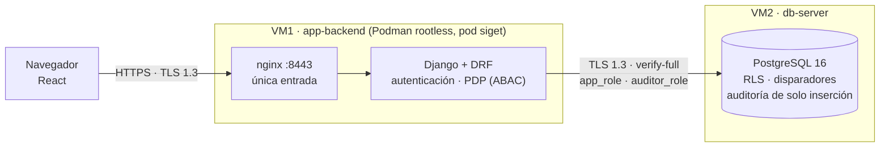

# SIGET — Sistema de Gestión y Trazabilidad

[](https://github.com/jeisonvasquez563-gif/siget/actions/workflows/backend-ci.yml)
[](https://github.com/jeisonvasquez563-gif/siget/actions/workflows/frontend-ci.yml)

Seguimiento **trazable y seguro** de los trámites ante el Estado panameño. Proyecto de gobierno digital de Ciberseguridad 5 (UTP). Referencia funcional inicial: Panamá Conecta.

**Autor:** Jeison Vásquez — Grupo Ciber5

## Problemática

Falta de trazabilidad y transparencia en el seguimiento de trámites ante el Estado: expedientes que quedan indefinidamente «en revisión», sin plazos exigibles ni rendición de cuentas. **La seguridad es el método, no el tema:** Zero Trust, sin superusuario y con auditoría inalterable garantizan que esa trazabilidad sea confiable.

## ▶ Abrir la plataforma

> **Guía completa: [`docs/como-abrir-la-plataforma.md`](./docs/como-abrir-la-plataforma.md)** · Presentación al profesor: [`docs/demo-guion.md`](./docs/demo-guion.md)

1. Enciende las dos VMs (`app-backend` y `db-server`) en VMware.
2. Instala la CA del proyecto una sola vez (Windows: `certutil -addstore -user Root infra\pki\siget-ca.crt`; otros sistemas en la guía).
3. Abre **https://192.168.159.137:8443** (o `https://100.104.206.118:8443` por Tailscale) e inicia sesión con una cuenta de demostración, su contraseña y el código de 6 dígitos del segundo factor.

Las contraseñas **no están en el repositorio**; se las pides al responsable (Jeison). ¿Solo quieres ver las pantallas, sin servidores? `cd frontend && npm install && npm run dev` y abre `http://localhost:5173/?mock=saul.mop` (datos de ejemplo, sin credenciales).

## Qué hace hoy

| | |
|---|---|
| **Ciudadanía** | Inicia trámites del catálogo y sigue su estado, plazo e historial (el «recorrido por esclusas») |
| **Personal** | Atiende la bandeja de su institución (lista y tablero), cambia estados con segundo factor reciente y confirma las resoluciones finales; el supervisor reasigna y atiende escalados |
| **Coordinación** | Ve al equipo y los roles de su institución, **sin** acceso a los datos de los trámites |
| **Plataforma** | Cinco roles (infraestructura, identidades, catálogo, seguridad, secretos) con **control dual** y sin acceso a trámites |
| **Auditoría** | Lee el registro inalterable con un rol de base de datos de solo lectura; cada consulta queda registrada |
| **Transparencia** | Matriz de roles y permisos **calculada por el propio motor de decisiones**, permisos reales de PostgreSQL y un **simulador de «qué pasaría si…»** |
| **Segundo factor** | TOTP obligatorio, anti-repetición, bloqueo por intentos, reautenticación escalonada y actividad de seguridad propia |

**No existe un superusuario:** ninguno de los 10 roles puede las 18 acciones del sistema (el que más puede, el supervisor, hace 6).

## Arquitectura



**Cada petición atraviesa cinco capas y ninguna confía en la anterior:** nginx/TLS → autenticación (token de 10 minutos, sesión, cuenta, segundo factor) → decisor de acceso (ABAC, niega por defecto) → seguridad por filas de PostgreSQL → disparadores y registro inalterable. Más en [`docs/estructura-plataforma.md`](./docs/estructura-plataforma.md).

## Stack

| Capa | Tecnología |
|---|---|
| Interfaz | React 18 + Vite, CSS propio (sin estilos en línea por la CSP), fuentes autohospedadas |
| API | Django 5.2 LTS + Django REST Framework, Argon2, PyJWT, pyotp, Fernet |
| Base de datos | PostgreSQL 16 en contenedor rootless, esquema `siget`, RLS |
| Plataforma | Rocky Linux 9.7, Podman rootless + Quadlet (systemd), nginx, SELinux enforcing, firewalld |
| Acceso del equipo | SSH solo por clave sobre Tailscale (WireGuard) |
| Calidad | pytest (354), Vitest + Testing Library + axe (130), ESLint, verificaciones contra la base real, GitHub Actions |

## Estructura del repositorio (monorepo)

```
.
├── backend/              # Django + DRF: apps autenticacion, autorizacion (PDP), tramites, catalogo,
│                         #   identidad, auditoria, nucleo; comandos verificar_* y sembrar_demo
├── frontend/             # React + Vite: pantallas por rol, sistema de diseño, pruebas, simulador de desarrollo
├── database/             # Esquema, diseño de roles, migraciones 002–007, pruebas SQL
├── infra/
│   ├── podman/           # Unidades Quadlet y nginx.conf de VM1 y VM2
│   └── pki/              # CA pública del proyecto
├── demo/                 # Ensayo automático de la demo, generador de códigos TOTP, capturas
├── docs/                 # Toda la documentación (ver índice en docs/README.md)
├── checkpoints/          # El PHP intermedio (se retira en la semana 6), separado a propósito
├── .github/workflows/    # backend-ci y frontend-ci
├── CHANGELOG.md          # Cada cambio, con su motivo
└── CONTRIBUTING.md       # Ramas, commits, documentación y seguridad
```

`demo-local/` (credenciales de demostración) y los respaldos `*.dump` **nunca se suben**: están en `.gitignore`.

## Documentación

Todo está en [`docs/`](./docs/README.md). Lo esencial:

| Documento | Para qué |
|---|---|
| [`como-abrir-la-plataforma.md`](./docs/como-abrir-la-plataforma.md) | **Abrir, probar y operar la plataforma** |
| [`historial-del-proyecto.md`](./docs/historial-del-proyecto.md) | **Todo lo que se hizo**, en orden, con decisiones, incidentes y lo que falta |
| [`demo-guion.md`](./docs/demo-guion.md) | Guion de la presentación, lista de verificación del día y plan B |
| [`abrir-a-internet.md`](./docs/abrir-a-internet.md) | **Pendiente:** publicar la plataforma a todo internet (opciones, riesgos y plan) |
| [`runbook.md`](./docs/runbook.md) | Paso a paso técnico de todo lo ejecutado (32 secciones) |
| [`api.md`](./docs/api.md) | Contrato de la API (frontera entre backend y frontend) |
| [`zero-trust-cobertura.md`](./docs/zero-trust-cobertura.md) | Cobertura de los 7 principios de Zero Trust (NIST SP 800-207) |
| [`organizacion-backend-frontend.md`](./docs/organizacion-backend-frontend.md) | Los dos frentes, hojas de ruta y definición de «terminado» |

## Flujo de trabajo (GitFlow)

- **`main`** — versión estable para entregar; solo recibe merges desde `develop` o `hotfix/*`.
- **`develop`** — integración.
- **`feature/backend-<tema>`** y **`feature/frontend-<tema>`** — un bloque de trabajo por rama y **un PR por frente**, con revisión cruzada.
- Mensajes con [Conventional Commits]; todo cambio actualiza el `CHANGELOG.md` y, si toca infraestructura, el runbook. Detalle en [`CONTRIBUTING.md`](./CONTRIBUTING.md).

Verificación local antes de un PR:

```bash
cd backend  && python -m pytest -q          # 354 pruebas, sin base de datos
cd frontend && npm run verificar            # lint + 130 pruebas + build
```

Las pruebas contra la base real (`verificar_*`) corren en VM1 dentro de una transacción que se revierte; ver el runbook.

## Regla de oro

Nunca se elimina ni se sobrescribe nada en las VMs sin aprobación explícita, caso por caso. Todo cambio se documenta antes de ejecutarse y se respalda la base antes de migrarla.

## Seguridad

- **Cero credenciales en git:** contraseñas, claves y secretos viven como `podman secret` en las VMs; las cuentas de demostración, solo en un archivo local ignorado.
- SELinux en `enforcing` en ambas VMs; SSH solo por clave; el superusuario de PostgreSQL no tiene contraseña y se rechaza por red.
- El acceso a PostgreSQL exige TLS 1.3 verificando el certificado y está restringido a la IP interna de la aplicación.
- Las cuentas de demostración son solo del laboratorio y se suspenden tras la presentación.

[Conventional Commits]: https://www.conventionalcommits.org/
