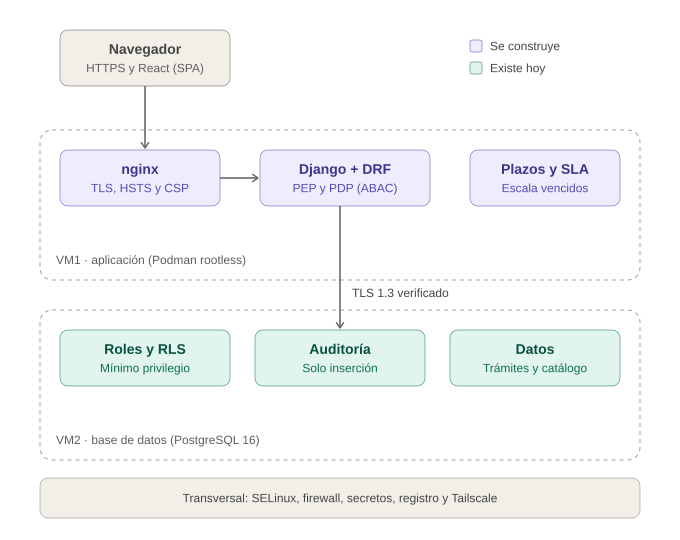

# Estructura de la plataforma SIGET

Explicación de cómo está organizada la plataforma: sus piezas, cómo se comunican, qué ocurre en cada petición y qué existe hoy frente a lo que se construye. Complementa el [diseño Zero Trust](./superpowers/specs/2026-10-08-arquitectura-zero-trust-design.md), los [módulos](./modulos.md) y los [roles y permisos de la base](./roles-permisos-bd.md).

*Teal: existe hoy. Morado: se construye.*

## 1. La idea en una frase

SIGET son dos máquinas con una sola puerta de entrada: la primera atiende al usuario y decide si puede pasar, la segunda guarda los datos y los protege por su cuenta, y entre ambas todo viaja cifrado.

## 2. Las tres piezas

| Pieza | Dónde corre | Qué hace | Qué no hace |
|---|---|---|---|
| Navegador | Equipo del usuario | Muestra la interfaz (React) y se comunica por HTTPS | No decide nada de seguridad: lo que decida el navegador se puede manipular |
| Aplicación | VM1, en contenedores Podman sin root | `nginx` cifra y es la única entrada; Django + DRF verifica identidad y decide el acceso; un temporizador escala los trámites vencidos | No accede a la base como superusuario |
| Base de datos | VM2, PostgreSQL 16 | Guarda los datos, filtra las filas por institución y mantiene una auditoría inalterable | No acepta conexiones sin TLS ni del superusuario por red |

## 3. Qué pasa cuando una persona consulta su trámite

1. La persona entra por HTTPS a `nginx`, que pasa la petición a Django.
2. Django verifica su sesión y su segundo factor y arma su contexto: quién es, qué pide, de qué institución y desde dónde.
3. El decisor de acceso (PDP) evalúa las reglas con atributos. Si ninguna permite, se niega. Si el decisor falla, también se niega.
4. Se registra la decisión, sea permitida o negada, con los atributos usados.
5. Django consulta la base por TLS 1.3 verificando el certificado del servidor.
6. La base devuelve solo las filas que corresponden, aunque Django se equivocara: esa es la segunda barrera (RLS).
7. Si un funcionario cambia el estado, el cambio y su evento de auditoría se guardan en la misma transacción: se guardan los dos o ninguno.

Hay **dos barreras independientes**: el decisor de la aplicación y la base de datos. Si alguien vulnera la aplicación, la base sigue negando lo que no corresponde.

## 4. Qué existe hoy y qué no

| Parte | Estado | Detalle |
|---|---|---|
| Base de datos (VM2) | ✅ Existe | Esquema `siget`, roles sin superusuario, RLS, auditoría de solo inserción, TLS con la aplicación. **Corre en un contenedor Podman rootless** (desde el 20-oct); la instalación nativa antigua sigue encendida y se apagará con aprobación |
| Aislamiento y acceso (las dos VMs) | ✅ Existe | Red interna, firewall, SELinux, SSH solo por clave, Tailscale, registro persistente |
| Podman rootless | ✅ En uso en VM2 | Instalado en VM1 y VM2 con el usuario de servicio `siget`; en VM2 ya ejecuta PostgreSQL; en VM1 faltan `nginx` y Django |
| Aplicación de VM1 | ⏳ No existe | Hoy corre Apache + PHP (el checkpoint intermedio, que se retira en la semana 6), no `nginx` + Django |
| `nginx`, Django, plazos y SLA | ⏳ No existen | Se construyen en las semanas 3 a 7 |
| Frontend (React) | ⏳ No existe | Se construye en las semanas 6 a 9 |

La mitad inferior del diagrama es real. La mitad superior es el plan.

## 5. Dónde vive cada cosa en el repositorio

| Carpeta | Qué contiene |
|---|---|
| `backend/` | Django + DRF (hoy solo el README) |
| `frontend/` | React + Vite (hoy solo el README) |
| `infra/` | Unidades de Podman/Quadlet y configuración de las VMs |
| `database/` | Esquema, roles, migraciones, pruebas y demo |
| `checkpoints/` | El PHP intermedio, que se retira en la semana 6 |
| `docs/` | Toda la documentación |

## 6. Lo que sostiene todo

Franja inferior del diagrama: SELinux y firewall en las dos máquinas, secretos fuera del código, un registro persistente de lo que ocurre y acceso del equipo solo por Tailscale y con clave. Todo está hecho, salvo los secretos con `podman secret`, que llegan con la migración a contenedores.

## 7. Qué decir al profesor

- **Se puede afirmar con evidencia:** la capa de datos y la seguridad de la infraestructura están implementadas y probadas (24 pruebas contra el esquema real, TLS entre aplicación y base, roles sin superusuario).
- **No se debe afirmar:** que `nginx`, Django o el frontend existen. Existe su diseño, el esquema que los respalda y el plan con fechas (ver [`plan-semanas-1-2.md`](./architecture/plan-semanas-1-2.md)).
