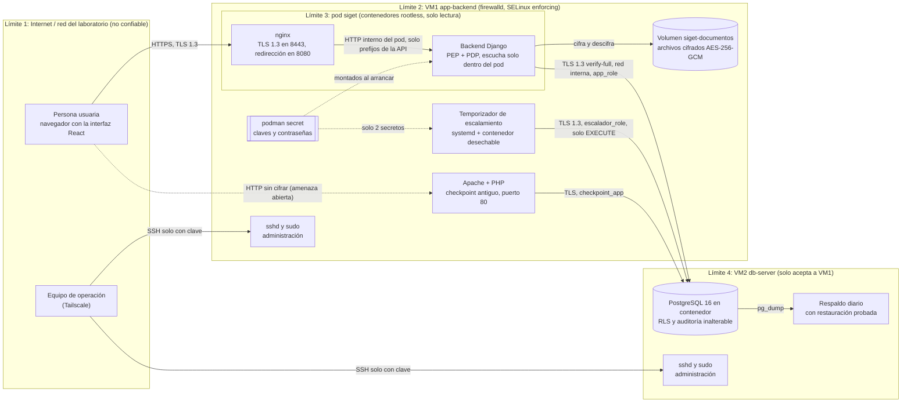

# Modelo de amenazas STRIDE

**Etapa 3: Diseño** · Responsable: **Joel Medina** · Revisa: **Andy Martínez**

> Elaborar el modelo de amenazas e incluir la seguridad como parte integral de la arquitectura. (Red Hat, *Seguridad en el ciclo de vida de desarrollo del software*.)

## Cómo se elaboró

1. STRIDE son seis tipos de amenaza. Para cada pieza de SIGET nos preguntamos si puede pasar cada una:
   **S**uplantación (alguien se hace pasar por otro) · **T**ampering, alteración (alguien modifica datos) · **R**epudio (alguien niega haber hecho algo) · **I**nformación divulgada (alguien ve lo que no debe) · **D**enegación de servicio (alguien tumba el sistema) · **E**levación de privilegios (alguien obtiene más permisos de los que tiene).
2. Partimos del diseño Zero Trust (`docs/superpowers/specs/2026-10-08-arquitectura-zero-trust-design.md`, sección 7) y de la matriz `docs/zero-trust-cobertura.md`, y dibujamos el diagrama de flujo de datos con sus **límites de confianza** (ver abajo).
3. Cada control que figura en las tablas se comprobó en el código o la configuración y se nombra el archivo donde está. Leímos la rama con las correcciones del análisis estático y dinámico (`fix/analisis-estatico-dinamico`) y las ramas ya desplegadas en producción: `feature/backend-plazos` (temporizador de escalamiento), `feature/backend-registro-configurable` y `feature/backend-documentos` (documentos adjuntos).
4. También usamos los hallazgos ya medidos: la revisión de seguridad del 22-oct (`docs/revision-seguridad-2026-10-22.md`), el informe de análisis (`docs/analisis-seguridad/README.md`), el runbook (`docs/runbook.md`) y el [registro de riesgos](./01-registro-de-riesgos.md) de la etapa 1 (los códigos R1, R2… remiten a él).
5. Estado: **Mitigada** (hay un control que la cubre y está comprobado) · **Parcial** (hay controles, pero queda un hueco concreto que se nombra) · **Abierta** (no hay control todavía). Cuando una pieza tiene dos amenazas distintas de la misma letra, se listan en dos filas.
6. La tabla del backend es el ejemplo original y se conserva tal cual.

## Componentes de SIGET

Navegador (interfaz React) → nginx (TLS 1.3, VM1) → backend Django (VM1) → PostgreSQL (VM2). Además: temporizador de escalamiento (VM1) y volumen de documentos cifrados (VM1). En VM1 sigue encendido el checkpoint PHP antiguo (Apache, puerto 80), que se retira con ZT-9.

## Diagrama de flujo de datos y límites de confianza

Un **límite de confianza** es la línea donde los datos pasan de una zona a otra con distinto nivel de confianza. En cada cruce hay que volver a verificar: quién es, qué puede hacer y si los datos llegaron intactos.

| Límite | Qué cruza | Qué se verifica al cruzar |
|---|---|---|
| 1 → 2 (internet o red del laboratorio → VM1) | Peticiones de las personas y SSH del equipo | TLS 1.3, nombres de host permitidos, límite de tasa (nginx); SSH solo con clave y firewall |
| 2 → 3 (VM1 → pod) | Solo el tráfico que nginx deja pasar | Únicamente los prefijos de la API llegan al backend; el backend no tiene puerto propio fuera del pod |
| 3 → 4 (pod → VM2) | Consultas SQL | TLS 1.3 con verificación del certificado, `pg_hba.conf` que solo admite a VM1, contraseña SCRAM, RLS |
| Dentro de VM1 (backend → volumen) | Archivos de documentos | Cifrado autenticado atado al trámite y a su ubicación; huella SHA-256 en la base |

## Ejemplo resuelto: backend Django

| STRIDE | Amenaza | Control en SIGET | Estado |
|---|---|---|---|
| S | Alguien usa un token robado de otra persona | Token de acceso de 10 minutos, sesiones revocables, segundo factor reciente para acciones sensibles | Mitigada |
| T | Alguien cambia el estado de un trámite saltándose las reglas | La base valida las transiciones con un trigger; el PDP decide antes | Mitigada |
| R | Un funcionario niega haber aprobado un trámite | Auditoría inalterable (`evento_auditoria`, sin UPDATE ni DELETE) | Mitigada |
| I | Un error muestra datos de otra institución | Seguridad por filas en la base además del PDP: dos barreras independientes | Mitigada |
| D | Una ráfaga de peticiones satura el inicio de sesión | Límites de tasa en nginx y en Django | Mitigada |
| E | Un ciudadano intenta actuar como funcionario | El PDP niega por defecto; ningún rol puede todo (matriz de permisos) | Mitigada |

## Navegador e interfaz

| STRIDE | Amenaza | Control en SIGET | Estado |
|---|---|---|---|
| S | Alguien adivina o roba la contraseña de una persona (ciudadana o funcionaria) y entra en su nombre | Contraseñas con Argon2 (`backend/apps/autenticacion/contrasenas.py`); segundo factor TOTP obligatorio para el personal y los roles de plataforma, y también para la ciudadanía por defecto (`mfa_obligatorio` en `servicio.py`, `SIGET_MFA_CIUDADANO_OBLIGATORIO` en `config/settings.py`); el secreto TOTP se guarda cifrado y un código no sirve dos veces (`mfa.py`); bloqueo progresivo tras 3 fallos (`bloqueo.py`) | Mitigada |
| T | La persona modifica la interfaz o las peticiones desde su navegador (herramientas de desarrollo, un proxy) para hacer algo que la pantalla no ofrece, o un sitio ajeno dispara una petición con su cookie (CSRF) | La interfaz no decide nada: el servidor vuelve a decidir en cada petición (`frontend/src/api.js`); toda la API nace denegada (`DenegarPorDefecto` en `config/settings.py`) y cada vista llama a `autorizar` (`backend/apps/autorizacion/permisos.py`). La cookie de refresco es `SameSite=Strict` y además se exige la cabecera `X-SIGET-CSRF` (`backend/apps/autenticacion/vistas.py`) | Mitigada |
| R | Una ciudadana niega haber creado un trámite o un funcionario niega haber iniciado sesión | Cada acción queda en `evento_auditoria`, cada decisión del PDP (permitida o negada) en `decision_pdp` y cada inicio de sesión en `evento_seguridad`, todas de solo inserción (`database/diseno-roles-permisos.sql`, `permisos.py` → `_registrar_decision`) | Mitigada |
| I | Un script inyectado (XSS) roba el token o lee datos en pantalla | CSP `default-src 'self'` sin scripts en línea (`infra/podman/vm1-app-backend/nginx.conf`); React escapa el texto y una prueba prohíbe `dangerouslySetInnerHTML`, `eval` y `new Function` (`frontend/src/pruebas/seguridad.prueba.js`); el token de acceso vive **solo en memoria** y el de refresco en una cookie `HttpOnly; Secure; SameSite=Strict` que JavaScript no puede leer (`api.js`, `vistas.py`). **Queda:** si un XSS llegara a ejecutarse, podría usar el token en memoria mientras la página esté abierta (hasta 10 minutos por token) | Parcial |
| I | Otra persona usa una sesión que quedó abierta en una computadora compartida | Cierre por inactividad a los 10 minutos en la interfaz con aviso de 60 segundos (`frontend/src/inactividad.jsx`), 15 minutos como máximo en el servidor y tope absoluto de 8 horas por sesión (`SIGET_REFRESH_MAX_EDAD_SEGUNDOS`, `SIGET_REFRESH_TTL_SEGUNDOS` en `config/settings.py`, `politica_sesion.py`); recargar la página devuelve al Inicio | Mitigada |
| D | Alguien bloquea a propósito la cuenta de otra persona fallando 3 veces su contraseña | Bloqueo progresivo de 5, 15 y 60 minutos que se reinicia al acertar (`bloqueo.py`) y límite de 10 intentos de inicio de sesión por minuto por dirección (`DEFAULT_THROTTLE_RATES` en `config/settings.py`). **Queda:** el bloqueo es por cuenta, no por dirección de origen, así que sigue siendo usable como ataque (hallazgo H-3; R11) | Parcial |
| E | Un ciudadano cambia su rol en la interfaz o fabrica un token para actuar como funcionario | El token no lleva roles: solo usuario, sesión y alcance; las membresías se leen de la base en cada petición. El algoritmo de firma está fijado al validar, así que un token con `alg: none` se rechaza (`backend/apps/autenticacion/tokens.py`); la clave de firma es un `podman secret` (`siget-backend.container`) | Mitigada |

## nginx

| STRIDE | Amenaza | Control en SIGET | Estado |
|---|---|---|---|
| S | Un intermediario en la red se hace pasar por SIGET con un certificado falso | Solo TLS 1.3 y HSTS de un año (`nginx.conf`); la clave TLS es un `podman secret` que solo lee el usuario de nginx (`siget-nginx.container`); la huella de la CA se publica para verificarla antes de confiar (`infra/pki/README.md`). **Queda:** la CA es interna; si la persona no la instaló, el navegador avisa «la conexión no es privada» y permite continuar, que es justo lo que aprovecharía un intermediario | Parcial |
| T | Alguien envía una cabecera `Host` o `X-Forwarded-For` falsa para desviar redirecciones o engañar el registro de direcciones | `map $host $host_permitido`: los nombres que no son de la plataforma reciben 421, en 8080 y en 8443 (`nginx.conf`, commit `a91c0ea`, evidencia `docs/analisis-seguridad/despues/14_host_header_8443.txt`); nginx **reemplaza** `X-Forwarded-For` por la dirección real (`$remote_addr`) | Mitigada |
| R | Alguien hace peticiones maliciosas y después lo niega | nginx registra cada petición (`access_log /dev/stdout`) y el journal de las VMs es persistente (runbook 14.6). **Queda:** los registros viven en la misma VM, no hay bitácora central ni alertas (hallazgo H-7; R22) | Parcial |
| I | El servidor revela versiones, rutas internas o archivos que no debería servir | `server_tokens off`, `proxy_hide_header X-Powered-By`, solo los prefijos de la API llegan al backend y todo lo demás responde 404 (`nginx.conf`); Apache con `ServerTokens Prod` y `TraceEnable Off` (`docs/analisis-seguridad/README.md`, «Aplicado en producción»); OWASP ZAP sin alertas de riesgo después de corregir (`docs/analisis-seguridad/despues/11_zap_escaneo.txt`) | Mitigada |
| I | Alguien en la misma red lee usuario y contraseña del checkpoint PHP antiguo, que se sirve por HTTP en el puerto 80 de VM1 | La plataforma nueva no tiene este problema (todo por TLS 1.3 y el puerto 8080 solo redirige con 301). El checkpoint tiene la cookie `HttpOnly` y `SameSite=Strict` (`docs/analisis-seguridad/README.md`), pero sin TLS su contraseña viaja en claro y la cookie no puede llevar `Secure`. Nmap lo confirma (`despues/10_nmap_puertos_tls.txt`). Plan: retirarlo y cerrar el puerto 80 (ZT-9 / PT-13; R8) | Abierta |
| D | Una ráfaga de peticiones desde una dirección satura el servicio | `limit_req` de 20 peticiones por segundo por dirección con respuesta 429, cuerpo máximo de 10 MB y tiempos de espera de 15 segundos (`nginx.conf`); además, límites por tipo de petición en Django con caché compartida entre procesos (`config/settings.py`, hallazgo H-4 corregido). Si se abre a internet detrás de un proxy, primero hay que leer la IP real (R19) | Mitigada |
| E | Una falla de nginx permite ejecutar código y saltar desde el contenedor al resto de VM1 | Contenedor rootless con `NoNewPrivileges`, `DropCapability=ALL`, sistema de archivos de solo lectura y configuración montada `:ro` (`siget-nginx.container`); SELinux en enforcing (runbook 12.5). **Queda:** la imagen de nginx no se reconstruye desde hace meses (UBI 9.7) y las VMs ya no tienen avisos pendientes desde el 16-nov-2026 (R5), pero la imagen sigue sin reconstruirse (R23) | Parcial |

## Base de datos PostgreSQL

| STRIDE | Amenaza | Control en SIGET | Estado |
|---|---|---|---|
| S | Alguien se conecta a la base haciéndose pasar por la aplicación, o una base falsa se hace pasar por la real | `pg_hba.conf` solo admite conexiones `hostssl` desde la IP interna de VM1 con SCRAM-SHA-256, y rechaza a `postgres` por red (`infra/podman/vm2-db-server/pg_hba.conf`); las contraseñas son `podman secret`; la aplicación verifica el certificado del servidor (`SIGET_DB_SSLROOTCERT`, `verify-full`, runbook 18) | Mitigada |
| T | Alguien, a través de la aplicación, borra o edita la auditoría o fuerza un estado de trámite inválido | Triggers `auditoria_inmutable`, `auditoria_sin_truncate`, `decision_inmutable` y `tramite_valida_transicion`; `app_role` solo tiene `SELECT, INSERT` sobre la auditoría (`database/diseno-roles-permisos.sql`); `app_role` no puede escribir `escalado_en` (migración 013, rama `feature/backend-plazos`) | Mitigada |
| R | Quien administra VM2 entra como superusuario local (por socket), desactiva un trigger, cambia datos y lo niega | `log_connections` y `log_disconnections` activos (runbook 33.5); journal persistente con el uso de `sudo` (runbook 14.6). **Queda:** una sola cuenta tiene sudo completo, y root puede borrar esos mismos registros porque no se copian fuera de la VM (R9, R22) | Parcial |
| I | Si el backend se compromete, quien lo controla lee hashes de contraseñas y de refresco, o datos de otra institución | RLS por institución en `tramite`, `evento_auditoria` y `documento`; `auditor_role` y `pgadmin_lectura` sin acceso a hashes (migración 009, hallazgo H-14); TLS 1.3 en tránsito; respaldos con permisos 600. **Queda:** `usuario` y `sesion` no tienen RLS y `app_role` las lee completas (hallazgo H-5) | Parcial |
| D | Se pierde la base (falla del disco, error humano) o se agotan sus conexiones | Límite de conexiones por rol (`app_role` 20, `auditor_role` 5, `escalador_role` 2; migraciones 003, 007 y 013); respaldo diario con **prueba de restauración** en cada corrida (`infra/podman/vm2-db-server/respaldo/siget-respaldo.sh`). **Queda:** los respaldos están en la misma VM2 y no hay segunda base (R7, R17) | Parcial |
| D | La única persona con sudo completo en las VMs no está disponible y nadie puede restaurar, parchar ni migrar | Procedimientos escritos paso a paso (runbook 33 a 37) y sudo acotado de Andy en VM1 (runbook 20). No hay una segunda persona capaz de operar VM2 (R9, decisión abierta) | Abierta |
| E | Quien controla `app_role` intenta volverse superusuario, crear roles o saltarse la RLS | Ningún rol del proyecto es superusuario ni tiene `BYPASSRLS` ni `CREATEROLE` (`diseno-roles-permisos.sql`); `REVOKE ALL ... FROM PUBLIC`; las funciones `SECURITY DEFINER` tienen `search_path` fijo (`siget, pg_temp`) | Mitigada |
| E | Un atacante aprovecha una vulnerabilidad conocida y sin parchar del sistema operativo de VM1 o VM2 para tomar la máquina | Solo hay barreras alrededor (SSH solo con clave, firewall, SELinux, contenedores rootless). El 16-nov-2026 se aplicaron los parches con respaldo e instantáneas previas: 0 avisos críticos y 0 actualizaciones pendientes en las dos VMs, y Rocky Linux 9.9 (antes 9.7 sin soporte) (`docs/sdlc/evidencia/10_parches_despues.txt`, `09_vm1_actualizacion.txt`, `09_vm2_actualizacion.txt`; R5, R10). Además se quitó la regla sobrante del puerto 5432 en VM2. **Queda:** el contenedor de PostgreSQL usa una imagen de docker.io y no quita capacidades (`siget-postgres.container`), (los repositorios externos pgdg con firma inválida de VM1 se deshabilitaron el 17-nov-2026; R24 mitigado) | Mitigada |

## Temporizador de escalamiento

| STRIDE | Amenaza | Control en SIGET | Estado |
|---|---|---|---|
| S | Alguien ejecuta la función de escalamiento haciéndose pasar por el temporizador, o la aplicación la invoca por su cuenta | `REVOKE ALL ON FUNCTION siget.escalar_vencidos() FROM PUBLIC` y solo `escalador_role` tiene `EXECUTE` (migración 013); ese rol solo entra con TLS desde VM1 y SCRAM (`pg_hba.conf`, rama `feature/backend-plazos`); su contraseña es el `podman secret` `siget-db-escalador-password` (`siget-escalar.service`) | Mitigada |
| T | Alguien adelanta o atrasa el reloj de las VMs para escalar trámites antes de tiempo o para que nunca venzan | La función compara con la hora de la base (`now()`) y es idempotente: un trámite no se escala dos veces (migración 013). **Queda:** `chrony` está apagado porque la red del laboratorio bloquea el NTP público; las VMs toman la hora del PC anfitrión por VMware, y si ese PC se desfasa, las VMs lo siguen (runbook 22.4) | Parcial |
| R | Nadie puede demostrar cuándo ni por qué se escaló un trámite | Cada escalamiento escribe, en la misma transacción, un evento `escalamiento` en `evento_auditoria` (inalterable) con la regla `plazo_vencido` y la fecha límite; el actor queda nulo porque lo hace el sistema (migración 013). El journal registra cada corrida del temporizador | Mitigada |
| I | El contenedor del temporizador expone claves que no necesita o lee datos de los trámites | `config/settings_escalador.py` se niega a arrancar si le llegan la clave de Django, la de los JWT o la del segundo factor; el contenedor recibe solo 2 secretos (contraseña del rol y CA) (`siget-escalar.service`); `escalador_role` no tiene `SELECT` sobre ninguna tabla (migración 013) | Mitigada |
| D | El temporizador falla (VM1 apagada, contenedor que no arranca, contraseña rotada) y los trámites vencidos no llegan a supervisión | `Persistent=true` corre lo atrasado al encender (`siget-escalar.timer`); la función es idempotente; el servicio queda en `failed` y se ve con `systemctl --user status`. **Queda:** nadie recibe un aviso automático cuando una corrida falla (R12, PT-10) | Parcial |
| E | Quien obtiene la contraseña de `escalador_role` la usa para leer o cambiar otras cosas | Rol `NOSUPERUSER NOINHERIT NOBYPASSRLS NOCREATEROLE` con `CONNECTION LIMIT 2` y solo `EXECUTE` sobre una función que únicamente marca `escalado_en` e inserta el evento (migración 013); contenedor `--read-only`, `--cap-drop=ALL` y `no-new-privileges` (`siget-escalar.service`) | Mitigada |

## Archivos de documentos

| STRIDE | Amenaza | Control en SIGET | Estado |
|---|---|---|---|
| S | Alguien sube un documento a un trámite ajeno haciéndose pasar por el solicitante | El PDP solo permite `adjuntar_documento` sobre el trámite propio (`pdp.py`); la RLS exige `subido_por = ctx_usuario()` y que el trámite sea de esa persona; un trigger impide que el documento quede en otra institución (`database/migraciones/015-documentos.sql`, rama `feature/backend-documentos`) | Mitigada |
| T | Alguien con acceso al disco modifica un archivo, lo copia a otro trámite o lo cambia de lugar | Cifrado AES-256-GCM con datos autenticados que atan el archivo a su trámite y a su ubicación: cualquier cambio impide descifrarlo (`backend/apps/tramites/documentos.py`); la huella SHA-256 guardada en la base se compara en cada descarga y, si no coincide, no se entrega y queda el evento `documento_alterado` (`vistas.py`); los metadatos no admiten `UPDATE` ni `DELETE` (trigger `documento_sin_cambios`); el archivo se escribe una sola vez con `O_EXCL` y permisos 600 (`almacen.py`) | Mitigada |
| R | Un ciudadano niega haber subido un documento, o un funcionario niega haberlo descargado | La subida deja un evento `documento_adjuntado` en `evento_auditoria` con el actor, y la fila guarda `subido_por` y la huella SHA-256 (`vistas.py`, migración 015). **Queda:** la descarga solo queda en `decision_pdp` como «ver documento» de esa institución, sin el número de documento (`permisos.py` → `_registrar_decision`) | Parcial |
| I | Alguien lee documentos de otra persona o de otra institución, o se lleva el disco | PDP más RLS (`documento_ver`); archivos cifrados en reposo; la ubicación en disco la genera el servidor (32 caracteres aleatorios) y nunca viene del cliente (`almacen.py`); descarga con `Cache-Control: no-store`. **Queda:** la clave (`siget-docs-key`) y los archivos están en la misma VM1, y quien puede operar como el usuario `siget` (la cuenta con sudo completo y Andy con `sudo -u siget`, runbook 20) puede leer las dos cosas | Parcial |
| D | Alguien llena el disco de VM1 subiendo archivos | Máximo 5 MB por archivo (`TAMANO_MAXIMO`), 20 por trámite (`SIGET_DOCS_POR_TRAMITE`), cuerpo máximo de 10 MB y límite de tasa en nginx. **Queda:** no hay cuota total del volumen ni aviso de disco lleno | Parcial |
| D | Se pierde la clave de documentos o el volumen, y los archivos quedan ilegibles para siempre | La clave existe solo como `podman secret` en VM1 y no tiene respaldo fuera de ella (runbook 37.2, punto 2); el volumen `siget-documentos` no tiene un respaldo automático implementado (el respaldo diario es solo de la base, en VM2) (R6) | Abierta |
| E | Un ciudadano sube un archivo malicioso (ejecutable disfrazado, PDF con código) para tomar el equipo del funcionario que lo abre | Lista cerrada de tipos (PDF, PNG, JPEG) detectados por los bytes mágicos y con la extensión obligada a coincidir; nada de SVG ni HTML (`documentos.py`); la descarga sale siempre como adjunto, con `nosniff` y `Content-Security-Policy: default-src 'none'; sandbox` (`vistas.py`). **Queda:** un PDF real con contenido malicioso pasa la validación porque no hay antivirus (ClamAV quedó como opcional y no se implementó; R4) | Parcial |

## Amenazas abiertas

Incluye las **abiertas** y las **parciales**, ordenadas de la más grave a la menos grave. Las abiertas van primero. La antigua A1 (VMs sin parches) pasó a **Mitigada** el 16-nov-2026 y queda al final como registro.

| # | Pieza | STRIDE | Amenaza | Estado | Qué falta | Riesgo |
|---|---|---|---|---|---|---|
| A2 | Documentos | D | Pérdida de la clave o del volumen de documentos | Abierta | Respaldar `siget-docs-key` fuera de VM1 y separada de los archivos; respaldo del volumen | R6 |
| A3 | nginx (VM1) | I | El checkpoint PHP envía la contraseña sin cifrar por el puerto 80 | Abierta | Retirar el checkpoint, cerrar el puerto 80 y rotar su contraseña de base | R8 |
| A4 | Base de datos | D | Una sola persona con sudo completo | Abierta | Decidir quién más puede operar VM2, al menos para restaurar | R9 |
| P1 | Documentos | E | PDF malicioso sin antivirus | Parcial | Análisis con ClamAV en un contenedor aparte | R4 |
| P2 | Documentos | I | Clave y archivos en la misma VM, legibles por quien opera como `siget` | Parcial | Guardar la clave fuera de VM1 (o en un custodio aparte) | R6 |
| P3 | Base de datos | D | Respaldos en la misma VM2, sin segunda base | Parcial | Copia fuera de VM2 | R7, R17 |
| P4 | Base de datos | R | El superusuario local puede alterar datos y borrar sus rastros | Parcial | Enviar los registros fuera de la VM y repartir la administración | R9, R22 |
| P5 | Base de datos | I | `app_role` lee completas las tablas `usuario` y `sesion` | Parcial | Vistas de inicio de sesión con `SECURITY DEFINER` y `REVOKE SELECT` de las columnas sensibles | H-5 |
| P6 | nginx | E | Imagen de nginx sin reconstruir | Parcial | Reconstruir la imagen y fijar una actualización periódica | R23 |
| P7 | Temporizador | D | Una corrida fallida no avisa a nadie | Parcial | Alerta automática ante fallos | R12 |
| P8 | Temporizador | T | El reloj depende del PC anfitrión | Parcial | Volver a `chrony` con NTS cuando la red lo permita | Runbook 22.4 |
| P9 | nginx | S | CA interna: si no se instala, el navegador avisa y deja continuar | Parcial | Certificado de una CA pública si se abre a internet | — |
| P10 | Navegador | D | Bloqueo de cuentas usable como ataque | Parcial | Bloqueo también por dirección de origen y restablecimiento asistido | R11, H-3 |
| P11 | nginx | R | Sin bitácora central ni alertas | Parcial | Alertas ante patrones y exportación firmada | R22 |
| P12 | Navegador | I | Un XSS podría usar el token en memoria | Parcial | Mantener la CSP estricta y la prueba de seguridad del frontend | — |
| P13 | Documentos | R | La descarga no registra qué documento se bajó | Parcial | Registrar el número de documento en la decisión o en la auditoría | — |
| P14 | Documentos | D | Sin cuota total del volumen | Parcial | Cuota o aviso de disco lleno | — |
| A1 | VM1 y VM2 (fila en la tabla de la base) | E | Vulnerabilidades sin parchar en el sistema operativo | **Mitigada** (16-nov-2026) | Hecho: actualización a Rocky 9.9, 0 críticos y 0 pendientes (`docs/sdlc/evidencia/10_parches_despues.txt`). Resta mantener la bitácora semanal y resolver los repositorios con firma inválida | R5, R10, R24 |

### Resumen por estado

| Estado | Ejemplo del backend | Piezas completadas | Total |
|---|---|---|---|
| Mitigada | 6 | 18 | 24 |
| Parcial | 0 | 14 | 14 |
| Abierta | 0 | 3 | 3 |
| **Total** | **6** | **35** | **41** |

**La amenaza abierta más grave** es ahora A2, la pérdida de la clave o del volumen de documentos: el daño no se puede revertir. La que lo era, A1 (los parches), se mitigó el 16-nov-2026: afectaba a las dos máquinas a la vez y una vulnerabilidad del sistema operativo podía saltarse todas las barreras de la aplicación.

## Preguntas que puede hacer el profesor

**1. ¿Qué es un modelo de amenazas y para qué les sirvió?**
Es un ejercicio de diseño en el que nos preguntamos, pieza por pieza, qué podría salir mal antes de que pase. Nos sirvió para encontrar huecos que no se ven probando la aplicación, como que la clave de los documentos no tiene respaldo, y para decidir qué arreglar primero.

**2. ¿Qué significa cada letra de STRIDE? Den un ejemplo de SIGET.**
S, suplantación: alguien entra con la contraseña de un funcionario (lo frenamos con el segundo factor). T, alteración: alguien edita la auditoría (la base lo rechaza). R, repudio: un funcionario dice «yo no aprobé eso» (la auditoría guarda quién lo hizo). I, información divulgada: el MOP ve trámites del MINSA (lo impiden el PDP y la RLS). D, denegación de servicio: una ráfaga al inicio de sesión (límites de tasa). E, elevación de privilegios: un ciudadano intenta actuar como funcionario (el PDP niega por defecto).

**3. ¿Qué es un límite de confianza?**
Es la frontera entre dos zonas en las que confiamos distinto, por ejemplo entre internet y VM1, o entre la aplicación y la base. Cada vez que un dato cruza una de esas fronteras lo volvemos a verificar: quién es, si tiene permiso y si llegó intacto. En SIGET marcamos cuatro: la red, VM1, el pod de contenedores y VM2.

**4. ¿Por qué tienen dos barreras, el PDP y la RLS, si hacen lo mismo?**
Porque partimos de la idea de que una barrera puede fallar. El PDP decide en el backend con todas las reglas (segundo factor reciente, conflicto de interés); la RLS se aplica dentro de la base y solo deja ver las filas de las instituciones autorizadas. Si un error de programación se salta el PDP, la base igual niega. De hecho, la RLS nos ayudó a descubrir un permiso demasiado amplio que corregimos (runbook 27).

**5. ¿Cuál es la amenaza abierta más grave?**
La pérdida de la clave de los documentos: si se pierde, los archivos cifrados quedan ilegibles para siempre, y hoy la clave existe solo en VM1. La que era la más grave, las máquinas virtuales sin parches (170 y 177 avisos, dos críticos en cada una), la mitigamos el 16-nov-2026: actualizamos las dos a Rocky 9.9 y quedaron en cero críticos y cero pendientes. Importaba mucho porque está por debajo de todo lo que construimos: si alguien toma el sistema operativo, nuestras reglas de aplicación ya no lo detienen.

**6. ¿Cómo se protege un documento que sube un ciudadano?**
Primero revisamos el contenido real del archivo, no solo su nombre: solo aceptamos PDF, PNG y JPEG de hasta 5 MB. Después lo ciframos con AES-256-GCM atado a su trámite, así que si alguien lo copia o lo cambia, deja de abrirse. Guardamos su huella SHA-256 y la comparamos en cada descarga, que siempre sale como archivo adjunto y nunca se abre dentro de la página. Lo que nos falta es un antivirus y respaldar la clave fuera de VM1.

**7. ¿Qué pasa si alguien roba un token?**
El token de acceso dura solo 10 minutos y vive en la memoria de la página, no guardado en el navegador. El de refresco va en una cookie que JavaScript no puede leer y sirve una sola vez: si alguien lo reutiliza, revocamos toda la sesión. Además, para cambiar un trámite pedimos otra vez el segundo factor si pasaron más de 15 minutos, así que un token robado solo no alcanza.

**8. ¿Por qué el temporizador de escalamiento tiene su propio rol de base de datos?**
Por mínimo privilegio: el temporizador solo necesita marcar los trámites vencidos. Su rol no puede leer ninguna tabla, solo ejecutar una función, y el contenedor no recibe las claves de la aplicación. Si alguien robara esa contraseña, lo único que podría hacer es escalar trámites que ya vencieron, y eso queda en la auditoría.

**9. ¿Por qué marcaron amenazas como «parcial» o «abierta» en vez de decir que todo está cubierto?**
Porque un modelo de amenazas que solo dice «mitigada» no sirve para decidir nada. Preferimos ser honestos: 24 mitigadas, 14 parciales y 3 abiertas, cada una con lo que falta y su riesgo en el registro de la etapa 1. Así el equipo sabe exactamente qué arreglar primero.

**10. ¿Cómo saben que los controles que nombran existen de verdad?**
Cada control de las tablas está en un archivo concreto del repositorio que nombramos, y muchos tienen pruebas automáticas o evidencia: por ejemplo, la prueba de que la auditoría no se puede borrar, el escaneo de ZAP y Nmap después de corregir, y la prueba de cabecera `Host` falsa que responde 421.
