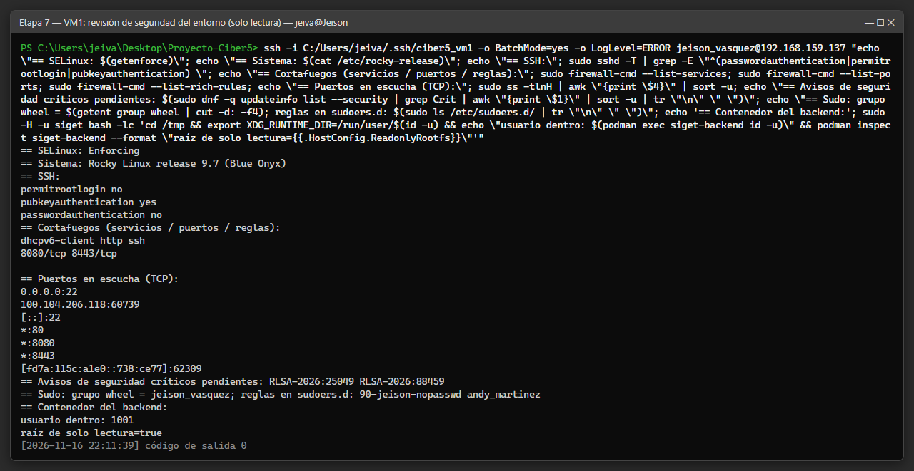
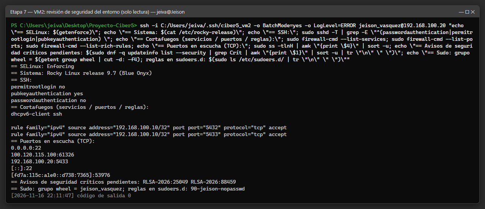
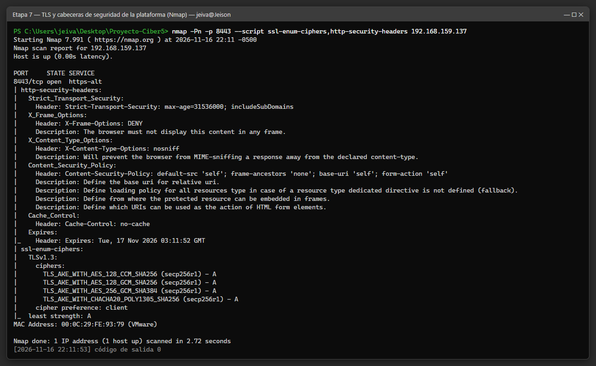

# Revisión de la seguridad del entorno de despliegue

**Etapa 7: Implementación** · Responsable: **Jeison Vásquez** · Revisa: **Andy Martínez**

> Evaluar la seguridad del entorno de despliegue y revisar las configuraciones de seguridad. (Red Hat, *Seguridad en el ciclo de vida de desarrollo del software*.)

## Cómo se elaboró

1. Todas las comprobaciones fueron de solo lectura, el 16-nov-2026, por SSH con llave desde el equipo del desarrollador hacia las dos máquinas virtuales (VM1 con la aplicación y VM2 con la base de datos). No se cambió nada.
2. Cada resultado se copió tal cual de la salida del comando y se marcó con ✅ (cumple lo esperado) o ⚠️ (hay algo que atender).
3. Lo que no dio lo esperado se pasó a «Hallazgos de la revisión». Nada se corrige sin respaldo y ventana acordada.

## Comprobaciones

| Comprobación | Comando | Esperado | VM1 | VM2 |
|---|---|---|---|---|
| SELinux | `getenforce` | Enforcing | ✅ Enforcing | ✅ Enforcing |
| Cortafuegos | `sudo firewall-cmd --list-all` | Solo los puertos necesarios | ⚠️ Servicios `ssh`, `dhcpv6-client` y `http`; puertos 8080 y 8443. El servicio `http` (puerto 80) ya no hace falta para SIGET | ⚠️ Solo `ssh` y `dhcpv6-client`, más dos reglas desde VM1 (puertos 5432 y 5433). La del 5432 sobra |
| SSH sin contraseña | `sudo sshd -T \| grep passwordauthentication` | no | ✅ `passwordauthentication no`, `permitrootlogin no`, `pubkeyauthentication yes` | ✅ Igual que VM1 |
| Puertos abiertos | `sudo ss -tlnp` | Solo los servicios de SIGET | ⚠️ En escucha: 22, 80, 8080 y 8443, más los puertos del acceso remoto privado. El 80 es el Apache del checkpoint PHP | ✅ En escucha: 22 y 5433 (PostgreSQL en contenedor, solo en la interfaz del laboratorio), más el acceso remoto. Nada escucha en el 5432 |
| Versión del sistema | `cat /etc/rocky-release` | La última versión menor (9.8) | ⚠️ Rocky Linux 9.7 | ⚠️ Rocky Linux 9.7 |
| Avisos críticos | `sudo dnf updateinfo list --security` | Ninguno crítico | ⚠️ 2 sin aplicar (RLSA-2026:25049 y RLSA-2026:88459) | ⚠️ 2 sin aplicar (los mismos dos) |
| Sudo | `getent group wheel`; `ls /etc/sudoers.d/` | Privilegios mínimos y conocidos | ✅ Un solo administrador con sudo completo y una regla de solo lectura para el revisor | ✅ Un solo administrador con sudo completo; el revisor no tiene sudo |
| TLS y cabeceras | `nmap --script ssl-enum-ciphers,http-security-headers -p 8443` | TLS 1.3, calificación A, HSTS y CSP | ✅ Solo TLS 1.3, cuatro suites todas con calificación A; HSTS (`max-age=31536000; includeSubDomains`), CSP, `X-Frame-Options: DENY` y `nosniff` | — |
| Contenedores sin root | `podman exec siget-backend id -u` | 1001 | ✅ Usuario 1001 dentro del contenedor y sistema de archivos raíz de solo lectura | — |

### Capturas

- VM1, revisión completa: 
- VM2, revisión completa: 
- TLS y cabeceras de seguridad en el puerto 8443: 

Las salidas en texto están en `evidencia/07_vm1_revision.txt`, `evidencia/07_vm2_revision.txt` y `evidencia/07_tls_cabeceras.txt`.

## Hallazgos de la revisión

| N.º | Hallazgo | Dónde | Riesgo | Propuesta |
|---|---|---|---|---|
| 1 | Puerto 80 abierto: es el Apache del checkpoint PHP, y el servicio `http` sigue permitido en el cortafuegos | VM1 | Medio: es una puerta que SIGET ya no usa | Cerrar el servicio `http` del cortafuegos y apagar Apache cuando el checkpoint se dé de baja, con respaldo previo de su configuración |
| 2 | Una regla del cortafuegos todavía permite el 5432 desde VM1, aunque el PostgreSQL nativo no se usa (la base corre en contenedor por el 5433) | VM2 | Bajo: hoy nadie escucha en ese puerto, pero una regla sin servicio es un descuido | Quitar la regla del 5432 y dejar solo la del 5433 |
| 3 | 2 avisos críticos por VM sin aplicar (RLSA-2026:25049 y RLSA-2026:88459) | VM1 y VM2 | Alto según nuestra regla: ningún crítico debe pasar de 7 días | Se resuelven con la actualización a 9.8 (ver abajo) |
| 4 | Rocky Linux 9.7: es una versión menor que dejó de recibir soporte cuando salió la 9.8 (28-may-2026) | VM1 y VM2 | Medio: ya no llegan correcciones nuevas para la 9.7 | Actualizar a 9.8 con el plan de abajo |

Lo que sí cumple: SELinux activo, acceso por SSH solo con llave y sin entrada directa del administrador del sistema, TLS 1.3 con cabeceras completas, contenedor sin privilegios y con disco de solo lectura, y un único administrador con sudo completo.

## Registro de la actualización a Rocky 9.8

**Estado: planificada y pendiente de aprobación.** Todavía no se ejecutó; la aprueba Jeison Vásquez como responsable de infraestructura. Los pasos previstos son:

1. **Respaldo previo.** Un respaldo manual de la base de datos (además del respaldo diario con restauración probada), copia de la configuración de nginx, del cortafuegos y de los archivos de servicio, y fotografía (snapshot) de cada VM.
2. **Ventana acordada.** Fecha y hora avisadas al equipo, fuera de horario de trámites, con VM2 (base de datos) primero y VM1 después.
3. **Actualizar.** `sudo dnf update` en cada VM y revisión de lo que se instala, en especial el kernel y los paquetes de Podman.
4. **Reiniciar.** Reinicio de la VM y comprobación de que arrancan solos los servicios, el contenedor de la base y el del backend, y los temporizadores de respaldo y de escalamiento.
5. **Verificaciones.** `cat /etc/rocky-release` debe decir 9.8, `getenforce` debe seguir en Enforcing, el cortafuegos y SSH sin cambios, y `dnf updateinfo summary` debe mostrar cero críticos. Se corren también los `verificar_*` del repositorio.
6. **Ensayo.** Se repite el ensayo completo (101 comprobaciones) y el escaneo dinámico, y se compara con el resultado anterior.
7. **Registro.** Se anota aquí la fecha, el respaldo usado, el resultado de `dnf update`, los reinicios y el ensayo, y se agrega al CHANGELOG. Si algo falla, se vuelve a la fotografía.

| Dato | Valor |
|---|---|
| Fecha de la ventana | A definir al aprobar |
| Respaldo previo | A registrar al ejecutar |
| Resultado de `dnf update` | A registrar al ejecutar |
| Reinicio y verificaciones | A registrar al ejecutar |
| Ensayo posterior | A registrar al ejecutar |

## Preguntas que puede hacer el profesor

**1. ¿Qué es el entorno de despliegue y por qué se revisa su seguridad?**
Es el lugar donde corre el sistema de verdad: las dos máquinas virtuales, su sistema operativo, su red y sus contenedores. Lo revisamos porque un programa bien escrito igual se puede atacar si el lugar donde vive está mal configurado. Es como cuidar un edificio: de nada sirve una buena puerta si dejamos una ventana abierta.

**2. ¿Qué es SELinux y por qué lo dejamos en «Enforcing»?**
Es un guardia dentro del sistema operativo que decide qué puede hacer cada programa, aunque el programa se vea comprometido. En «Enforcing» el guardia bloquea de verdad lo no permitido; en otros modos solo avisa. Lo tenemos así en las dos máquinas, y por eso, si un servicio fuera atacado, no podría tocar archivos ajenos.

**3. ¿Para qué sirve el cortafuegos y qué encontramos?**
Decide qué puertas de la máquina están abiertas a la red; lo correcto es abrir solo las necesarias. Encontramos dos sobrantes: el puerto 80 abierto en la máquina de la aplicación (un servidor del checkpoint antiguo) y una regla de la base de datos hacia un puerto que ya no se usa. No son graves, pero cada puerta de más es una puerta que alguien podría probar.

**4. ¿Por qué se prohíbe entrar por SSH con contraseña?**
Porque una contraseña se puede adivinar o probar miles de veces. Con llave, solo entra quien tiene el archivo de la llave. Lo comprobamos: en las dos máquinas la contraseña está desactivada y el administrador del sistema no puede entrar directamente.

**5. ¿Qué es TLS y qué resultado obtuvimos?**
Es el cifrado que protege lo que viaja entre el navegador y el servidor, el candado del navegador. El escaneo mostró que solo se acepta TLS 1.3, la versión más reciente, y todas sus suites tienen la calificación más alta (A). Además el servidor envía cabeceras que le dicen al navegador que use siempre HTTPS y que no permita incrustar la página en otros sitios.

**6. ¿Qué son las cabeceras de seguridad, como HSTS y CSP?**
Son instrucciones que el servidor le manda al navegador para protegernos. HSTS obliga a usar siempre conexión cifrada; CSP limita de dónde se puede cargar contenido y evita que se inyecten scripts ajenos. Las dos están activas en la plataforma.

**7. ¿Por qué el contenedor del backend no corre como administrador?**
Porque si alguien rompiera la aplicación, heredaría los permisos con que corre. Nuestro contenedor usa un usuario común (el número 1001) y además su disco es de solo lectura, así que un intruso no podría instalar nada ni modificar el programa. Es el principio de dar el mínimo permiso necesario.

**8. ¿Qué es un contenedor y qué ventaja tiene?**
Es una caja que lleva dentro la aplicación con todo lo que necesita, aislada del resto del sistema. Ventaja: si algo falla o se ataca, queda contenido en la caja, y se puede reconstruir igual cada vez. Usamos Podman, que además permite correr sin ser administrador.

**9. ¿Por qué la versión 9.7 de Rocky Linux es un hallazgo?**
Porque cuando sale una versión menor nueva (la 9.8), Red Hat y Rocky dejan de crear correcciones para la anterior. Seguir en la 9.7 es como usar una aplicación que ya no recibe actualizaciones: lo que se descubra después ya no se arregla ahí. Por eso planificamos subir a la 9.8.

**10. ¿Por qué no actualizamos de inmediato, si hay avisos críticos?**
Porque una actualización grande puede romper algo, y primero necesitamos respaldo, una ventana acordada y la aprobación del responsable de infraestructura. Está planificada y pendiente de aprobación. Después repetimos el ensayo completo para comprobar que todo sigue funcionando.
