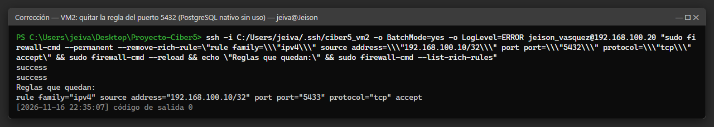
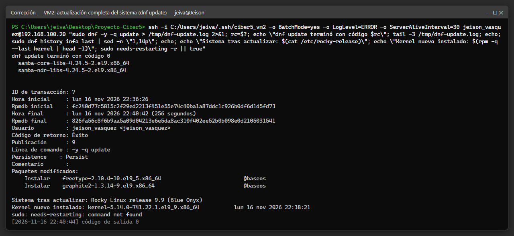
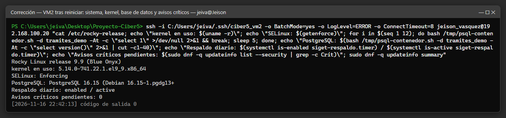
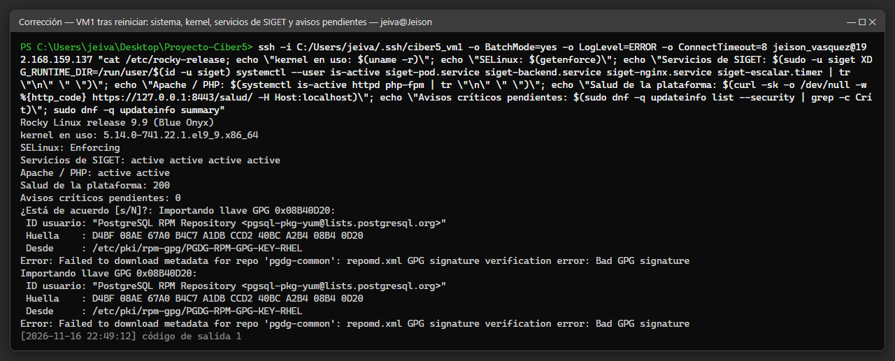
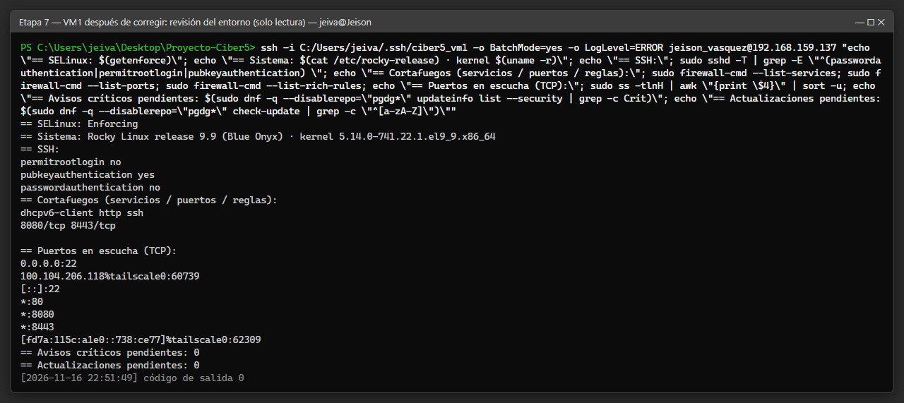
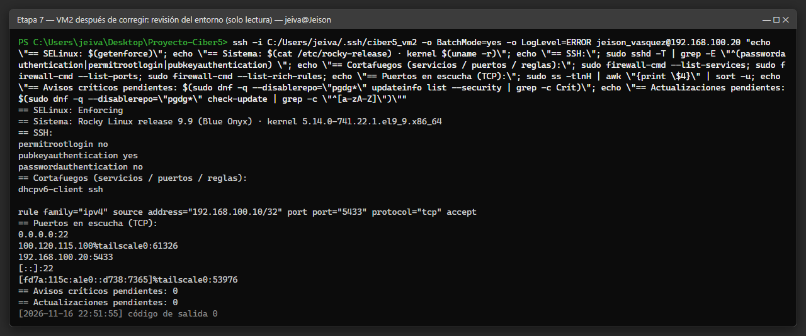
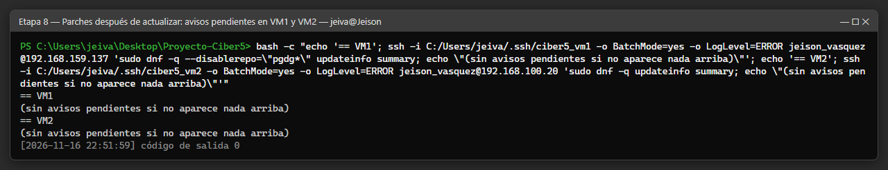
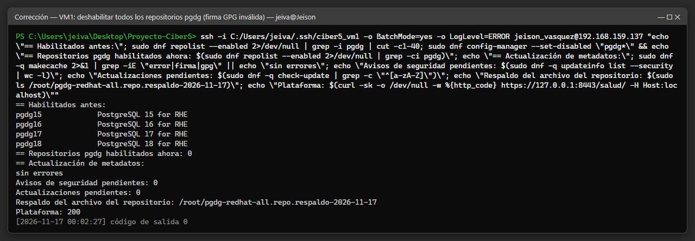

# Revisión de la seguridad del entorno de despliegue

**Etapa 7: Implementación** · Responsable: **Jeison Vásquez** · Revisa: **Andy Martínez**

> Evaluar la seguridad del entorno de despliegue y revisar las configuraciones de seguridad. (Red Hat, *Seguridad en el ciclo de vida de desarrollo del software*.)

## Cómo se elaboró

1. La revisión inicial fue de solo lectura, el 16-nov-2026, por SSH con llave desde el equipo del desarrollador hacia las dos máquinas virtuales (VM1 con la aplicación y VM2 con la base de datos). En ese momento no se cambió nada.
2. Cada resultado se copió tal cual de la salida del comando y se marcó con ✅ (cumple lo esperado) o ⚠️ (hay algo que atender).
3. Lo que no dio lo esperado se pasó a «Hallazgos de la revisión». Nada se corrige sin respaldo.
4. Ese mismo día, con respaldo e instantáneas previas, se corrigieron los hallazgos 2, 3 y 4 y se repitió la revisión en solo lectura. Los resultados están en «Después de la corrección» y el procedimiento en «Registro de la actualización». Los hallazgos 1 y 5 se cerraron el 17-nov-2026.
5. Desde el 24-nov-2026 cada cambio que toca las VMs (migraciones 016 a 020, el rol del detector, la configuración de nginx) se aplicó con el procedimiento de la sección «Cambios del entorno desde el 17 de noviembre», a partir de los registros del runbook (secciones 39 a 44). **La revisión de solo lectura completa no se repitió después del 17-nov**: lo de esa sección sale de los registros de cada aplicación y de su evidencia (`evidencia/14_*` a `19_*`).

## Comprobaciones (antes de corregir)

| Comprobación | Comando | Esperado | VM1 | VM2 |
|---|---|---|---|---|
| SELinux | `getenforce` | Enforcing | ✅ Enforcing | ✅ Enforcing |
| Cortafuegos | `sudo firewall-cmd --list-all` | Solo los puertos necesarios | ⚠️ Servicios `ssh`, `dhcpv6-client` y `http`; puertos 8080 y 8443. El servicio `http` (puerto 80) ya no hace falta para SIGET | ⚠️ Solo `ssh` y `dhcpv6-client`, más dos reglas desde VM1 (puertos 5432 y 5433). La del 5432 sobra |
| SSH sin contraseña | `sudo sshd -T \| grep passwordauthentication` | no | ✅ `passwordauthentication no`, `permitrootlogin no`, `pubkeyauthentication yes` | ✅ Igual que VM1 |
| Puertos abiertos | `sudo ss -tlnp` | Solo los servicios de SIGET | ⚠️ En escucha: 22, 80, 8080 y 8443, más los puertos del acceso remoto privado. El 80 es el Apache del checkpoint PHP | ✅ En escucha: 22 y 5433 (PostgreSQL en contenedor, solo en la interfaz del laboratorio), más el acceso remoto. Nada escucha en el 5432 |
| Versión del sistema | `cat /etc/rocky-release` | La última versión menor publicada | ⚠️ Rocky Linux 9.7 | ⚠️ Rocky Linux 9.7 |
| Avisos críticos | `sudo dnf updateinfo list --security` | Ninguno crítico | ⚠️ 2 sin aplicar (RLSA-2026:25049 y RLSA-2026:88459) | ⚠️ 2 sin aplicar (los mismos dos) |
| Sudo | `getent group wheel`; `ls /etc/sudoers.d/` | Privilegios mínimos y conocidos | ✅ Un solo administrador con sudo completo y una regla de solo lectura para el revisor | ✅ Un solo administrador con sudo completo; el revisor no tiene sudo |
| TLS y cabeceras | `nmap --script ssl-enum-ciphers,http-security-headers -p 8443` | TLS 1.3, calificación A, HSTS y CSP | ✅ Solo TLS 1.3, cuatro suites todas con calificación A; HSTS (`max-age=31536000; includeSubDomains`), CSP, `X-Frame-Options: DENY` y `nosniff` | — |
| Contenedores sin root | `podman exec siget-backend id -u` | 1001 | ✅ Usuario 1001 dentro del contenedor y sistema de archivos raíz de solo lectura | — |

### Capturas

- VM1, revisión completa: 
- VM2, revisión completa: 
- TLS y cabeceras de seguridad en el puerto 8443: 

Las salidas en texto están en `evidencia/07_vm1_revision.txt`, `evidencia/07_vm2_revision.txt` y `evidencia/07_tls_cabeceras.txt`.

## Después de la corrección (16-nov-2026)

Misma revisión, repetida en solo lectura después de actualizar y reiniciar las dos máquinas.

| Comprobación | Antes | Después en VM1 | Después en VM2 |
|---|---|---|---|
| SELinux | ✅ Enforcing | ✅ Enforcing | ✅ Enforcing |
| Cortafuegos | ⚠️ VM1: `http` abierto; VM2: reglas 5432 y 5433 | ⚠️ Sin cambios a propósito: `ssh`, `dhcpv6-client`, `http`; puertos 8080 y 8443. El puerto 80 sigue abierto (checkpoint PHP, hallazgo 1) | ✅ `ssh`, `dhcpv6-client` y una sola regla desde VM1, la del 5433. La del 5432 se quitó |
| SSH sin contraseña | ✅ | ✅ `passwordauthentication no`, `permitrootlogin no`, `pubkeyauthentication yes` | ✅ Igual |
| Puertos abiertos | ⚠️ VM1: 22, 80, 8080 y 8443 | ⚠️ Igual que antes: 22, 80, 8080 y 8443 (más el acceso remoto privado) | ✅ 22 y 5433 (más el acceso remoto privado) |
| Versión del sistema | ⚠️ Rocky 9.7 en las dos | ✅ Rocky Linux 9.9, kernel 5.14.0-741.22.1.el9_9 en uso | ✅ Rocky Linux 9.9, mismo kernel |
| Avisos críticos | ⚠️ 2 por VM | ✅ 0 | ✅ 0 |
| Actualizaciones pendientes | 203 avisos de seguridad en VM1 y 192 en VM2 | ✅ 0 | ✅ 0 |
| Servicios tras reiniciar | — | ✅ Los 4 servicios de SIGET (pod, backend, nginx y temporizador de escalamiento) activos; Apache y PHP activos; la salud de la plataforma responde 200 | ✅ PostgreSQL responde (16.15) y el temporizador del respaldo diario sigue habilitado y activo |
| Podman | — | ✅ 5.8.5 | — |

Nota: en VM1 las cifras de avisos se tomaron desactivando los repositorios `pgdg*` (hallazgo 5); en VM2 no hizo falta.

Verificaciones contra la base real después del reinicio: `verificar_tramites` 77/77, `verificar_plataforma` 91/91 y `verificar_autenticacion` 84/84. El ensayo completo contra producción dio 101/101.

### Capturas de la corrección

- VM2, regla del 5432 quitada: 
- VM2, actualización: 
- VM2 tras reiniciar: 
- VM1, actualización: 
- VM1 tras reiniciar (aquí aparece el error de firma de los repositorios pgdg): 
- VM1, revisión después: 
- VM2, revisión después: 
- Avisos pendientes después: 

Las salidas en texto tienen los mismos nombres con extensión `.txt`, en `evidencia/`.

## Hallazgos de la revisión

| N.º | Hallazgo | Dónde | Riesgo | Estado (16-nov) | Qué se hizo o qué falta |
|---|---|---|---|---|---|
| 1 | Puerto 80 abierto: es el Apache del checkpoint PHP, y el servicio `http` sigue permitido en el cortafuegos | VM1 | Medio: es una puerta que SIGET ya no usa | **Corregido (17-nov-2026)** | Con respaldo previo (`/root/respaldo-pt13-2026-11-17`) se detuvieron y deshabilitaron Apache y php-fpm, lo que retira el checkpoint PHP y también pgAdmin web, que compartía el puerto 80 sin cifrar. Se quitó `http` del cortafuegos y el rol `checkpoint_app` quedó sin inicio de sesión. Después: el 80 no responde, el 8443 sí, 77/77, 91/91, 84/84 y ensayo 101/101 (`evidencia/13_*`) |
| 2 | Una regla del cortafuegos todavía permitía el 5432 desde VM1, aunque el PostgreSQL nativo no se usa (la base corre en contenedor por el 5433) | VM2 | Bajo | **Corregido** | Regla quitada; solo queda la del 5433 (`evidencia/09_vm2_cortafuegos.txt`, `10_vm2_revision_despues.txt`) |
| 3 | 2 avisos críticos por VM sin aplicar (RLSA-2026:25049 y RLSA-2026:88459) | VM1 y VM2 | Alto según nuestra regla: ningún crítico debe pasar de 7 días | **Corregido** | `dnf update` en las dos VMs: 0 críticos y 0 actualizaciones pendientes (`evidencia/10_parches_despues.txt`) |
| 4 | Rocky Linux 9.7: versión menor sin soporte desde que salió la 9.8 (28-may-2026) | VM1 y VM2 | Medio | **Corregido** | Las dos VMs quedaron en Rocky Linux 9.9, la última versión menor publicada (`evidencia/09_vm1_actualizacion.txt`, `09_vm2_actualizacion.txt`) |
| 5 | **Nuevo.** VM1 tenía habilitados seis repositorios externos de PostgreSQL (`pgdg-common` y `pgdg14` a `pgdg18`), que quedaron de la instalación de pgAdmin del checkpoint. Su firma GPG falla (`Bad GPG signature`) y dnf se niega a usarlos | VM1 | Bajo: dnf bloquea los paquetes, pero un repositorio externo con firma inválida no debe seguir habilitado | **Corregido el 17-nov-2026** | Se respaldó `/etc/yum.repos.d/pgdg-redhat-all.repo` y se deshabilitaron los seis con `dnf config-manager --set-disabled "pgdg*"`. `dnf` actualiza sin errores, 0 avisos y 0 actualizaciones pendientes, y la plataforma sigue respondiendo:  (R24) |

Lo que sí cumple: SELinux activo, acceso por SSH solo con llave y sin entrada directa del administrador del sistema, TLS 1.3 con cabeceras completas, contenedor sin privilegios y con disco de solo lectura, y un único administrador con sudo completo.

Resumen: de 5 hallazgos, **los 5 corregidos**: 2, 3 y 4 el 16-nov-2026, y 1 y 5 el 17-nov-2026.

## Registro de la actualización a Rocky 9.9

**Estado: ejecutada el 16-nov-2026.** La actualización se había planificado a la 9.8, pero al ejecutarla la 9.9 ya estaba publicada y Rocky solo soporta la última versión menor, así que las dos VMs quedaron en **Rocky Linux 9.9**. Pasos reales:

1. **Respaldo previo.** Respaldo manual y verificado de la base (`tramites_demo-20261116-222436.dump`), además del respaldo diario, y una instantánea de VMware de VM1 y de VM2 llamada «antes-de-rocky-9.8-2026-11-16» (el nombre conserva la versión que se había planificado).
2. **Corrección del cortafuegos de VM2.** Se quitó la regla del puerto 5432 y quedó solo la del 5433 (22:35). 
3. **VM2 primero: actualizar.** `sudo dnf update` terminó con código 0 en 256 segundos (transacción 7, de 22:36 a 22:40) y dejó Rocky Linux 9.9 con el kernel 5.14.0-741.22.1.el9_9. 
4. **VM2: reiniciar y comprobar.** Arrancaron solos PostgreSQL y el temporizador del respaldo diario; SELinux en Enforcing y 0 avisos críticos. 
5. **VM1 después: actualizar.** `sudo dnf update` terminó con código 0 en 245 segundos (transacción 12, de 22:43 a 22:47): Rocky Linux 9.9, el mismo kernel y Podman 5.8.5. 
6. **VM1: reiniciar y comprobar.** Arrancaron solos los servicios de SIGET, Apache y PHP con su endurecimiento; la plataforma respondió 200 y SELinux siguió en Enforcing. Aquí apareció el hallazgo 5 (repositorios pgdg con firma inválida). 
7. **Verificaciones.** Revisión del entorno repetida (ver «Después de la corrección»), `verificar_tramites` 77/77, `verificar_plataforma` 91/91 y `verificar_autenticacion` 84/84 contra la base real.   
8. **Ensayo.** Ensayo completo contra producción: 101/101.
9. **Registro.** Este documento, la bitácora de parches (`08-bitacora-parches.md`) y el registro de riesgos. Las instantáneas se conservaron hasta confirmar que todo seguía bien y se borraron el 17-nov-2026 (`evidencia/12_instantaneas_borradas`). VMware dejó los discos marcados para consolidar, porque la consola tenía los archivos abiertos; se completa con «Manage > Clean Up Disks» con las VMs apagadas, y mientras tanto las VMs funcionan igual.

| Dato | Valor |
|---|---|
| Fecha de la ventana | 16-nov-2026, de 22:24 a 22:52 aproximadamente |
| Respaldo previo | `tramites_demo-20261116-222436.dump` y las instantáneas «antes-de-rocky-9.8-2026-11-16» de VM1 y VM2 |
| Resultado de `dnf update` | Código 0 en las dos VMs (256 s en VM2 y 245 s en VM1); Rocky Linux 9.9 |
| Reinicio y verificaciones | Todo arrancó solo; 0 avisos críticos y 0 actualizaciones pendientes en las dos VMs; 77/77, 91/91 y 84/84 |
| Ensayo posterior | 101/101 contra producción |

## Cambios del entorno desde el 17 de noviembre

Entre el 24 y el 26 de noviembre se aplicaron seis cambios en producción (migraciones 016 a 020 y el cambio de contraseña, sin migración). Todos siguieron el mismo procedimiento y dejaron su registro en el runbook y su evidencia en `evidencia/14_*` a `19_*`.

| Cambio del entorno | Qué se hizo | Cómo se cuidó | Registro |
|---|---|---|---|
| Rol `detector_role` en la base (26-nov) | Línea nueva en `pg_hba.conf` de VM2 (solo desde VM1, con TLS y SCRAM, como `escalador_role`) y rol con `LOGIN`, sin superusuario ni `BYPASSRLS`, solo `EXECUTE` sobre `siget.detectar_anomalias()` | El archivo se editó con `tee -a` **en el mismo inodo** (está montado en el contenedor de PostgreSQL), con respaldo `pg_hba.conf.respaldo-2026-11-26`, permisos 644 y `pg_reload_conf()` sin error; `log_statement` estaba en `none` | Runbook 43.10, punto 4; `evidencia/18_alertas_migracion` |
| Contraseña de `detector_role` (26-nov) | Generada en VM2 (40 caracteres), fijada por la entrada estándar de `psql` y pasada por una tubería SSH directo a `podman secret create siget-db-detector-password -` | **Nunca se mostró ni se guardó en un archivo**; el contenedor del detector recibe solo ese secreto y la CA | Runbook 43.10, punto 5 |
| Temporizador `siget-detectar.timer` (26-nov) | Unidad de systemd de usuario en VM1, cada 5 minutos con `Persistent=true`, que corre `manage.py detectar_anomalias` en un contenedor desechable con `config/settings_detector.py` (se niega a arrancar si le llegan las claves de Django, JWT o segundo factor) | Es idéntica a la del escalador salvo los nombres; primera corrida a mano: 0 alertas; `systemctl --user disable --now siget-detectar.timer` lo detiene sin tocar datos | Runbook 43.10, punto 7; `evidencia/18_alertas_verificaciones_despliegue_y_temporizador` |
| Lista de rutas de nginx (24-nov) | Se agregó `notificaciones` a la lista de `location` de `nginx.conf`: el ensayo daba 112/112 pero desde afuera `/notificaciones/` respondía 404 | Respaldo `nginx.conf.respaldo-2026-11-24`, escritura **en el mismo inodo** (el archivo está montado en el contenedor), `nginx -t` dentro del contenedor y `nginx -s reload` sin cortar conexiones; luego 401 sin sesión | Runbook 42.9, punto 5; `evidencia/17_notificaciones_nginx` |
| Cada migración (24 y 26-nov) | Migraciones 016, 017, 018, 019 y 020 en VM2, como `siget_owner`, en una sola transacción | Respaldo verificado con copia `pre-0NN` fuera de la rotación de 14 días; ensayo con `ROLLBACK` junto con sus pruebas; migración real y las mismas pruebas sobre la base migrada | Runbook 39 a 44 |
| Cada despliegue de la aplicación (24 y 26-nov) | Imagen nueva y interfaz nueva en VM1 | La imagen anterior se guarda como `siget-backend:respaldo-AAAA-MM-DD` y la interfaz en `frontend.respaldo-…`; las **ocho verificaciones se corren contra la base real antes de reiniciar**; ensayo completo al final | Runbook 39.10 a 44.9 |

**Dos lecciones del entorno.** La primera: un archivo montado en un contenedor (`pg_hba.conf`, `nginx.conf`) se edita en el mismo inodo; si se reemplaza el archivo, el contenedor sigue viendo el viejo. La segunda: ninguna prueba que hable directo con Django ve lo que nginx deja pasar, por eso el ensayo atraviesa nginx con una sesión real.

**Lo que sigue pendiente en el entorno** (no son hallazgos nuevos): la unidad del backend de VM1 conserva la inactividad de 2 minutos de la demostración y hay que volverla a 10 (R21); la copia de los respaldos fuera de VM2 (R7); una segunda persona con sudo (R9); y la segunda copia de la clave de documentos fuera del PC anfitrión (R6).

## Preguntas que puede hacer el profesor

**1. ¿Qué es el entorno de despliegue y por qué se revisa su seguridad?**
Es el lugar donde corre el sistema de verdad: las dos máquinas virtuales, su sistema operativo, su red y sus contenedores. Lo revisamos porque un programa bien escrito igual se puede atacar si el lugar donde vive está mal configurado. Es como cuidar un edificio: de nada sirve una buena puerta si dejamos una ventana abierta.

**2. ¿Qué es SELinux y por qué lo dejamos en «Enforcing»?**
Es un guardia dentro del sistema operativo que decide qué puede hacer cada programa, aunque el programa se vea comprometido. En «Enforcing» el guardia bloquea de verdad lo no permitido; en otros modos solo avisa. Lo tenemos así en las dos máquinas, y por eso, si un servicio fuera atacado, no podría tocar archivos ajenos.

**3. ¿Para qué sirve el cortafuegos y qué encontramos?**
Decide qué puertas de la máquina están abiertas a la red; lo correcto es abrir solo las necesarias. Encontramos dos sobrantes: el puerto 80 abierto en la máquina de la aplicación (un servidor del checkpoint antiguo) y una regla de la base de datos hacia un puerto que ya no se usa. Las dos se resolvieron: la regla sobrante se quitó el 16 de noviembre y el puerto 80 se cerró el 17, al retirar el checkpoint. No eran graves, pero cada puerta de más es una puerta que alguien podría probar.

**4. ¿Por qué se prohíbe entrar por SSH con contraseña?**
Porque una contraseña se puede adivinar o probar miles de veces. Con llave, solo entra quien tiene el archivo de la llave. Lo comprobamos: en las dos máquinas la contraseña está desactivada y el administrador del sistema no puede entrar directamente.

**5. ¿Qué es TLS y qué resultado obtuvimos?**
Es el cifrado que protege lo que viaja entre el navegador y el servidor, el candado del navegador. El escaneo mostró que solo se acepta TLS 1.3, la versión más reciente, y todas sus suites tienen la calificación más alta (A). Además el servidor envía cabeceras que le dicen al navegador que use siempre HTTPS y que no permita incrustar la página en otros sitios.

**6. ¿Qué son las cabeceras de seguridad, como HSTS y CSP?**
Son instrucciones que el servidor le manda al navegador para protegernos. HSTS obliga a usar siempre conexión cifrada; CSP limita de dónde se puede cargar contenido y evita que se inyecten scripts ajenos. Las dos están activas en la plataforma.

**7. ¿Por qué el contenedor del backend no corre como administrador?**
Porque si alguien rompiera la aplicación, heredaría los permisos con que corre. Nuestro contenedor usa un usuario común (el número 1001) y además su disco es de solo lectura, así que un intruso no podría instalar nada ni modificar el programa. Es el principio de dar el mínimo permiso necesario.

**8. ¿Qué es un contenedor y qué ventaja tiene?**
Es una caja que lleva dentro la aplicación con todo lo que necesita, aislada del resto del sistema. Ventaja: si algo falla o se ataca, queda contenido en la caja, y se puede reconstruir igual cada vez. Usamos Podman, que además permite correr sin ser administrador.

**9. ¿Por qué la versión 9.7 de Rocky Linux era un hallazgo y qué hicieron?**
Porque cuando sale una versión menor nueva, Red Hat y Rocky dejan de crear correcciones para la anterior. Seguir en la 9.7 era como usar una aplicación que ya no recibe actualizaciones. Lo corregimos el 16-nov-2026: las dos máquinas quedaron en la 9.9, que es la última publicada (la 9.8 había salido el 28-may-2026 y ya fue reemplazada).

**10. ¿Por qué no actualizaron de inmediato, si había avisos críticos?**
Porque una actualización grande puede romper algo, y primero necesitábamos respaldo e instantáneas. Los hicimos el mismo día, actualizamos y repetimos el ensayo completo. Resultado: 0 avisos críticos y 0 actualizaciones pendientes en las dos máquinas, y el ensayo dio 101/101.

**11. ¿Cómo hicieron la actualización sin riesgo?**
Con cinco cuidados. (1) Respaldo verificado de la base antes de empezar. (2) Una instantánea de VMware de cada máquina, para volver atrás si algo fallaba. (3) Una máquina por vez: primero VM2 (la base) y, cuando quedó bien, VM1. (4) Reinicio y comprobación de que todo arranca solo: servicios de SIGET, Apache y PHP, PostgreSQL y el respaldo diario. (5) Verificaciones contra la base real (77/77, 91/91 y 84/84) y el ensayo completo contra producción (101/101). Nada se dio por bueno sin esa evidencia.

**12. ¿Qué les queda pendiente en el entorno?**
Ninguno de los cinco hallazgos. El último, el puerto 80 con el checkpoint PHP, lo cerramos el 17 de noviembre: se decidió aparte porque retirar el checkpoint no tiene vuelta atrás para quien lo usaba. De paso se retiró pgAdmin web, que compartía ese puerto sin cifrar y que SIGET no usa. El otro hallazgo de la actualización, seis repositorios externos de PostgreSQL con firma inválida en VM1, lo corregimos el 17 de noviembre deshabilitándolos, con respaldo de su configuración.

**13. ¿Qué cambió en el entorno cuando se agregaron las alertas?**
Tres cosas: un rol nuevo en la base, `detector_role`, que solo puede ejecutar una función y entra únicamente desde VM1 con TLS y contraseña; una línea nueva en `pg_hba.conf` de VM2, editada en el mismo archivo con respaldo y recarga sin cortar nada; y un temporizador de systemd en VM1 que corre cada 5 minutos en un contenedor desechable. Su contraseña se generó en VM2 y viajó por una tubería directo a un secreto de Podman, sin mostrarse ni guardarse en ningún archivo.

**14. ¿Por qué importa editar `pg_hba.conf` o `nginx.conf` «en el mismo inodo»?**
Porque esos archivos están montados dentro de un contenedor. Si un editor crea un archivo nuevo y reemplaza al anterior, el contenedor sigue apuntando al archivo viejo y el cambio parece aplicado pero no lo está. Por eso agregamos la línea con `tee -a` o escribimos sobre el mismo archivo, comprobamos que el inodo es el mismo antes y después, validamos con `nginx -t` y recargamos sin cortar conexiones.

**15. ¿Cómo evitan que un cambio defectuoso llegue a producción?**
Con un procedimiento fijo en cada cambio: respaldo verificado de la base con una copia que la rotación no borra, ensayo de la migración con sus pruebas en una transacción que se revierte, migración real, la imagen nueva construida con otra etiqueta y verificada con las ocho verificaciones contra la base real antes de reiniciar, despliegue con respaldo de la imagen anterior y ensayo completo al final. Si algo falla antes de reiniciar, producción no se tocó, y siempre está escrito cómo volver atrás.
