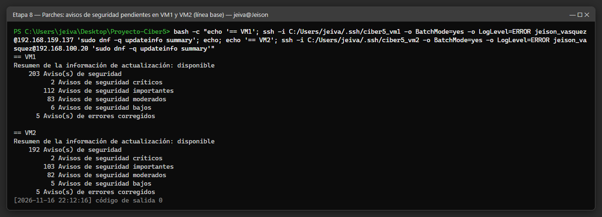
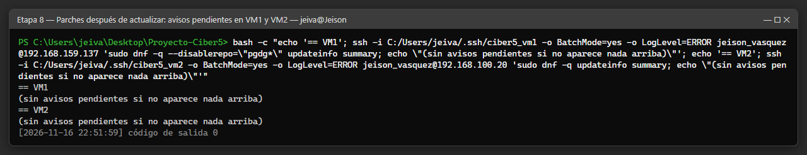

# Bitácora de parches y calendario de fin de soporte

**Etapa 8: Mantenimiento (parches y dependencias)** · Responsable: **Walter Sanjur** · Revisa: **Jeison Vásquez**

> Eliminar los puntos vulnerables que se descubran y mantener el sistema actualizado. (Red Hat, *Seguridad en el ciclo de vida de desarrollo del software*.)

## Cómo se elaboró

1. Cada lunes se revisan en GitHub los PR de Dependabot y el resultado del CI de seguridad.
2. Jeison Vásquez corre `sudo dnf updateinfo summary` en las dos VMs, en solo lectura, y los números se anotan aquí. La línea base se tomó el 16-nov-2026 (captura abajo).
3. Regla: ningún aviso **crítico** puede quedar más de 7 días sin aplicar.
4. Se revisa el calendario de fin de soporte y se avisa con un mes de anticipación.

## Bitácora semanal

| Semana | Avisos críticos VM1 / VM2 | Importantes VM1 / VM2 | PR de Dependabot | CI de seguridad | Acción |
|---|---|---|---|---|---|
| Línea base: 16-nov-2026 (antes de actualizar) | 2 / 2 | 112 / 103 | — | — | Plan de actualización, con respaldo e instantáneas previas |
| 16-nov-2026 (después de actualizar) | 0 / 0 | 0 / 0 | — | — | `dnf update` en VM2 y luego en VM1, reinicio y verificaciones; las dos VMs quedaron en Rocky Linux 9.9 |
| 23-nov-2026 | A completar en la próxima revisión |  |  |  |  |

Totales de la línea base: VM1 tiene 203 avisos de seguridad (2 críticos, 112 importantes, 83 moderados y 6 bajos) y VM2 tiene 192 (2 críticos, 103 importantes, 82 moderados y 5 bajos). Hay además 5 avisos de errores corregidos en cada una. Los dos críticos son los mismos en ambas (RLSA-2026:25049 y RLSA-2026:88459). Ese día seguían sin aplicarse, así que se incumplía la regla de 7 días. Se resolvieron la misma noche con la actualización completa del sistema (`dnf update`).

Salida en texto: `evidencia/08_parches_linea_base.txt`.

### Después de actualizar (16-nov-2026)

Después de actualizar y reiniciar, las dos VMs tienen **0 avisos críticos, 0 importantes y 0 actualizaciones pendientes**, y quedaron en Rocky Linux 9.9 con el kernel 5.14.0-741.22.1.el9_9. La regla de 7 días vuelve a cumplirse. En VM1 la medición se hizo desactivando los repositorios externos `pgdg*`, cuya firma era inválida. El 17-nov-2026 se deshabilitaron los seis y `dnf` volvió a funcionar sin errores ni avisos pendientes (hallazgo 5 de `07-revision-del-entorno.md` y riesgo R24, ya corregidos).

Salida en texto: `evidencia/10_parches_despues.txt`. El detalle de la actualización (respaldo, instantáneas, VM2 primero, reinicios y verificaciones) está en `07-revision-del-entorno.md`, con las capturas `evidencia/09_*.png`.

## Calendario de fin de soporte (del informe de mantenimiento)

| Componente | Fin de soporte | Avisar el | Estado |
|---|---|---|---|
| Python 3.12 (Application Stream de RHEL 9) | Abril de 2027 | Marzo de 2027 | Pendiente |
| Rocky Linux 9.7 (versión menor) | Sin soporte desde el 28-may-2026 | — | **Resuelto: 9.9 (16-nov-2026)** |
| Rocky Linux 9: soporte activo | 31-may-2027 | Abril de 2027 | Pendiente |
| Django 5.2 | Abril de 2028 | Marzo de 2028 | Pendiente |
| nginx 1.26 | Mayo de 2028 | Abril de 2028 | Pendiente |
| PostgreSQL 16 | 9-nov-2028 | Octubre de 2028 | Pendiente |
| Rocky Linux 9: soporte de seguridad | 31-may-2032 | Migrar antes | Pendiente |

La versión menor Rocky 9.7 dejó de recibir soporte cuando salió la 9.8 (28-may-2026). Se resolvió el 16-nov-2026: las dos VMs están en la 9.9, la última publicada (la 9.8 ya había sido reemplazada), según la etapa 7. Como Rocky solo soporta la última versión menor, cada vez que salga una nueva habrá que volver a actualizar.

## Preguntas que puede hacer el profesor

**1. ¿Qué es un parche y por qué lo aplicamos?**
Es una corrección que publica el fabricante cuando se descubre un fallo en un programa. Los atacantes leen esas mismas publicaciones y buscan sistemas que aún no las aplicaron. Por eso aplicarlas a tiempo cierra la puerta antes de que la usen.

**2. ¿Qué es un aviso RLSA?**
Es el aviso de seguridad que publica Rocky Linux (Rocky Linux Security Advisory) cuando corrige una vulnerabilidad. Equivale a los avisos de Red Hat (RHSA), y cada uno trae su gravedad: crítica, importante, moderada o baja. En la línea base cada máquina tenía dos críticos pendientes; después de actualizar quedaron en cero.

**3. ¿Qué es un CVE?**
Es el número de identificación público de una vulnerabilidad conocida, como un documento de identidad. Un aviso RLSA puede corregir uno o varios CVE. Gracias a ese número, todo el mundo habla del mismo fallo y se puede buscar qué afecta.

**4. ¿Qué diferencia hay entre crítico e importante?**
Crítico significa que el fallo puede aprovecharse con facilidad y causar un daño grande, a menudo sin que el atacante necesite entrar antes. Importante es grave pero más difícil de explotar. Nuestra regla es que ningún crítico pase más de 7 días sin aplicarse.

**5. ¿Por qué importa la versión menor (9.7 frente a 9.9)?**
Porque las correcciones nuevas se publican para la versión menor más reciente. Cuando salió la 9.8, la 9.7 dejó de recibirlas. Quedarnos en la 9.7 nos dejaba con un sistema que ya no se cuida, aunque siga funcionando. Por eso el 16-nov-2026 subimos las dos máquinas a la 9.9, que ya había reemplazado a la 9.8.

**6. ¿Qué es el fin de soporte?**
Es la fecha en que el fabricante deja de publicar correcciones de seguridad para un producto. Después, cualquier fallo nuevo se queda sin arreglar para siempre. Usar algo sin soporte es como conducir con frenos que ya nadie va a reparar.

**7. ¿Por qué llevamos un calendario de fin de soporte?**
Para saber con tiempo qué se vence y no enterarnos tarde. Cambiar Python, Django o la base de datos lleva tiempo de pruebas, así que avisamos un mes antes de cada fecha. Por ejemplo, Python 3.12 vence en abril de 2027 y avisamos en marzo.

**8. ¿Qué es Dependabot y para qué lo usamos?**
Es una herramienta de GitHub que vigila las librerías que usa el proyecto y abre solicitudes (PR) automáticas cuando sale una versión nueva o una corrección de seguridad. Nos ahorra revisar a mano cientos de librerías. Cada lunes revisamos esos PR y el resultado de las pruebas antes de aceptarlos.

**9. ¿Por qué no aplicamos todos los parches de inmediato y sin mirar?**
Porque un parche puede romper algo que funciona. Antes hacemos un respaldo, elegimos una ventana, actualizamos, reiniciamos y repetimos el ensayo completo para comprobar que todo sigue bien. Los críticos tienen prioridad, pero siempre con ese cuidado.

**10. ¿Cómo sabemos que estamos al día?**
Con una medición semanal: corremos `dnf updateinfo summary` en las dos máquinas y anotamos cuántos avisos faltan, por gravedad. La línea base del 16-nov-2026 (2 críticos y 112 y 103 importantes por VM) fue el punto de partida; ese mismo día, después de actualizar, quedó en 0 críticos y 0 importantes. Cada semana comparamos para comprobar que se mantiene en cero.

**11. ¿Cómo hicieron la actualización sin riesgo?**
Con cinco cuidados. (1) Respaldo verificado de la base antes de empezar. (2) Una instantánea de VMware de cada máquina, para volver atrás si algo fallaba. (3) Una máquina por vez: primero VM2 (la base) y, cuando quedó bien, VM1. (4) Reinicio y comprobación de que todo arranca solo: servicios de SIGET, Apache y PHP, PostgreSQL y el respaldo diario. (5) Verificaciones contra la base real (77/77, 91/91 y 84/84) y el ensayo completo contra producción (101/101). Resultado: 0 avisos críticos y 0 actualizaciones pendientes en las dos máquinas.
