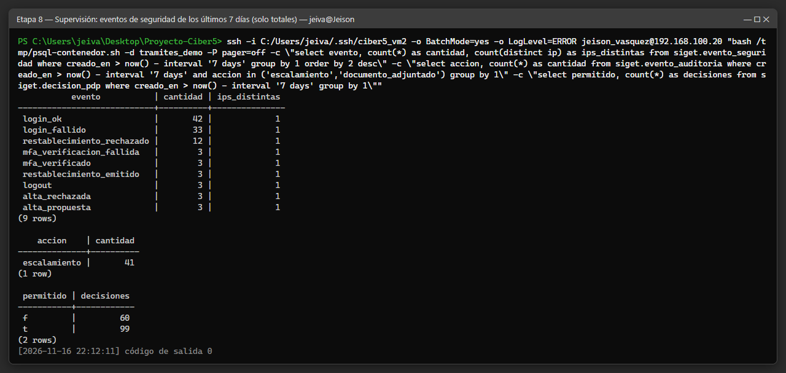
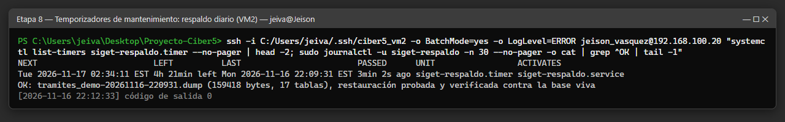
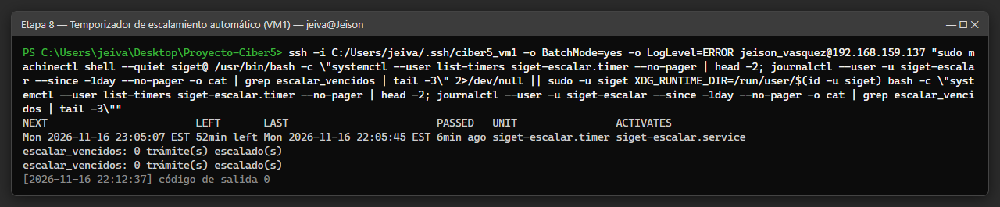

# Bitácora semanal de supervisión de seguridad

**Etapa 8: Mantenimiento (supervisión)** · Responsable: **Anyurie Sánchez** · Revisa: **Walter Sanjur**

> Supervisar el sistema para detectar amenazas y estar preparados para responder a una intrusión. (Red Hat, *Seguridad en el ciclo de vida de desarrollo del software*.)

## Cómo se elaboró

1. Una vez por semana se consultan, solo en lectura, los eventos de seguridad, la auditoría y las decisiones del motor de autorización (PDP) de los últimos 7 días. La primera entrada se sacó el 16-nov-2026 de la base de datos, mostrando solo totales.
2. Se revisan los inicios de sesión fallidos, los restablecimientos y altas rechazados, los fallos del segundo factor, los accesos denegados y los escalamientos, y se mira cuántas IP distintas hay detrás.
3. Se anota una fila por semana, con la interpretación en palabras.
4. Si aparece algo raro (muchos fallos desde una misma IP sin explicación, un acceso denegado repetido, un documento alterado), se avisa a Jeison Vásquez el mismo día.
5. Desde el 26-nov-2026 la revisión semanal empieza por la **consola de alertas** (PT-10): las alertas abiertas son lo primero que se mira, y los totales de siempre sirven para ponerlas en contexto.

## Bitácora

| Semana | Eventos de seguridad (total) | Inicios fallidos | Escalamientos | Decisiones denegadas / permitidas | Algo raro | Aviso a |
|---|---|---|---|---|---|---|
| Semana del 16-nov-2026 | 105 en 9 tipos, todos desde una sola IP | 33 | 41 | 60 / 99 | Nada que sea un ataque (ver la interpretación) | Jeison Vásquez, solo informativo |
| Semana del 23-nov-2026 (hasta el 26-nov) | No se midieron los totales de la semana | — | — | — | 2 alertas abiertas el 26-nov, abiertas por el detector (ver «La consola de alertas»); las provocó el ensayo a propósito | Quedaron abiertas para mostrar su revisión en la defensa (runbook 43.10) |
| 30-nov-2026 | A completar en la próxima revisión |  |  |  |  |  |

### Detalle de la semana del 16-nov-2026

| Evento de seguridad | Cantidad |
|---|---|
| `login_ok` (inicio de sesión correcto) | 42 |
| `login_fallido` | 33 |
| `restablecimiento_rechazado` | 12 |
| `mfa_verificacion_fallida` | 3 |
| `mfa_verificado` | 3 |
| `restablecimiento_emitido` | 3 |
| `logout` | 3 |
| `alta_rechazada` | 3 |
| `alta_propuesta` | 3 |

Escalamientos en la auditoría: 41. Decisiones del PDP: 60 denegadas y 99 permitidas.

**Interpretación, con honestidad:**

- **Una sola IP.** Los nueve tipos de evento vienen de una única IP: son las verificaciones y el ensayo del propio equipo, no ataques. Un ataque real de fuerza bruta se vería como muchos fallos desde muchas IP, o desde una sola contra muchas cuentas, y no es lo que hay.
- **41 escalamientos.** Son de la primera corrida del temporizador de escalamiento sobre trámites que ya estaban vencidos. No es una ola de atrasos nuevos: es el temporizador poniéndose al día. Las corridas siguientes (cada hora) registraron 0.
- **60 decisiones denegadas.** Son esperables, porque el ensayo incluye pruebas negativas que comprueban que el sistema rechaza lo que debe rechazar (por ejemplo, un usuario intentando algo que su rol no permite). Que haya denegadas es señal de que el control funciona.
- **Fallos de inicio de sesión, restablecimientos y altas rechazados, y fallos del segundo factor.** Son las mismas pruebas negativas de contraseñas, códigos y solicitudes inválidas.
- **Limitación.** Esta consulta no cuenta las cuentas bloqueadas por separado, y como todo viene de una IP todavía no sirve para medir ataques reales. La comparación útil empieza con la semana siguiente.

### Mantenimiento automático comprobado

- El respaldo diario de la base de datos corrió el 16-nov: el volcado se restauró y se verificó contra la base viva, y el siguiente está programado.
- El temporizador de escalamiento corre cada hora y su última ejecución fue normal.

Salidas en texto: `evidencia/08_supervision_semana.txt`, `evidencia/08_temporizadores.txt` y `evidencia/08_temporizador_escalamiento.txt`.

## La consola de alertas como herramienta de supervisión

Desde el 26-nov-2026 (PT-10, migración 019) un detector corre cada 5 minutos y abre una alerta cuando ve un patrón sospechoso. Es una herramienta de supervisión nueva: no reemplaza la revisión semanal, pero hace que lo urgente no espere a la semana siguiente.

| Regla | Qué detecta | Umbral | Severidad |
|---|---|---|---|
| Ráfaga de fallos desde una IP | `login_fallido` o `cambio_contrasena_fallido` desde una misma IP | 10 en 10 minutos | Media |
| Denegaciones del PDP de una persona | Decisiones negadas a una misma persona | 5 en 10 minutos | Media |
| Reuso de un token de refresco | Cualquier `refresh_reuso` | 1 | Alta |
| Bloqueos repetidos | `cuenta_bloqueada` de una misma cuenta | 2 en 24 horas | Alta |

**Cómo se revisa una alerta (operador de seguridad, con segundo factor reciente):**

1. Abrir «Alertas de seguridad» en la consola de respuesta a incidentes y filtrar por las abiertas.
2. Leer la regla en lenguaje llano, la persona o la IP, el conteo y la primera y última vez. El detalle lleva solo contadores y nombres: nunca cédula, correo ni credenciales.
3. Decidir si es real. Si lo es, seguir el procedimiento ante una intrusión (abajo). Si no, es una prueba, un error de la persona o un caso esperado.
4. Marcarla como **revisada** o **descartada**, con una **nota obligatoria**. Eso se puede hacer una sola vez; la alerta no se borra ni se reabre, y queda quién la revisó y cuándo (la hora la fija la base).
5. El auditor ve las mismas alertas en solo lectura, en una pestaña de «Auditoría».

**Lo que la consola no hace:** no bloquea cuentas por su cuenta (la decisión es humana) y no avisa si el propio detector se detiene (pendiente, R12 y R22 del registro de riesgos). Tampoco hay todavía exportación firmada de la auditoría.

**Interpretación de las dos primeras alertas, con honestidad:** el 26-nov, después del ensayo completo (116/116), el detector abrió dos alertas de denegaciones del PDP: `fabio.mop` con 6 e `ivan.identidades` con 5. No son un ataque: el ensayo provoca esas negaciones a propósito para comprobar que el sistema rechaza lo que no debe (runbook 43.9). Se dejaron abiertas para mostrar en la defensa cómo las revisa el operador. Por la misma razón, ninguna cuenta nueva del ensayo debe llegar a 5 negaciones en 10 minutos. Evidencia: `evidencia/18_alertas_ensayo_y_deteccion`.

## Procedimiento ante una intrusión

| Paso | Qué hacer | Quién |
|---|---|---|
| 1 | No apagar ni borrar nada ni reiniciar: la evidencia se pierde | Quien lo detecta |
| 2 | Avisar a Jeison de inmediato, con hora, qué se vio y desde dónde | Quien lo detecta (normalmente Anyurie Sánchez) |
| 3 | Bloquear la cuenta afectada y revocar sus sesiones desde la consola del operador de seguridad (ese rol bloquea, revoca y revisa alertas; no lee trámites ni toca la auditoría) | Jeison Vásquez, con Anyurie Sánchez presente |
| 4 | Preservar la evidencia antes de tocar nada más: copia del journal de las dos VMs, exportación de los eventos de seguridad y de la auditoría, y un respaldo de la base con su suma de verificación | Jeison Vásquez |
| 5 | Contener: cerrar en el cortafuegos el puerto o la IP de origen, y apagar solo el servicio afectado si es necesario | Jeison Vásquez |
| 6 | Evaluar: qué cuentas y datos se vieron, desde cuándo y por qué camino, cruzando el journal, la auditoría, las decisiones del PDP y las alertas abiertas con su nota | Anyurie Sánchez (supervisión) con Jeison Vásquez |
| 7 | Corregir: cerrar la causa (parche, configuración, claves y contraseñas rotadas), restaurar desde el respaldo si hubo daño, y comprobar con el ensayo | Walter Sanjur (parches) y Jeison Vásquez |
| 8 | Documentar: anotar lo ocurrido en el CHANGELOG y en el runbook, con las lecciones aprendidas y la fecha, y reflejarlo en esta bitácora | Jeison Vásquez (aprueba) y Anyurie Sánchez (redacta) |

## Preguntas que puede hacer el profesor

**1. ¿Qué es supervisar el sistema y por qué es parte del ciclo de vida seguro?**
Es mirar de forma regular lo que pasa en el sistema para notar cosas raras a tiempo. Red Hat lo ubica en la etapa de mantenimiento porque el sistema no queda seguro «para siempre» al entregarlo: cada semana aparecen amenazas nuevas. Sin supervisión, un ataque podría pasar semanas sin que nadie se entere.

**2. ¿Qué se monitorea en SIGET?**
Los eventos de seguridad (inicios de sesión, fallos, segundo factor, altas y restablecimientos), la auditoría de lo que se hace con los trámites, las decisiones del motor de autorización, las alertas que abre el detector cada 5 minutos, y el estado de los respaldos y temporizadores. Cada semana revisamos los totales y a cuántas IP corresponden.

**3. ¿Qué es un evento de seguridad?**
Es un registro automático de algo que importa para la protección: alguien entró, falló al entrar, pidió cambiar su contraseña o fue rechazado. Uno solo casi nunca prueba nada; lo que informa es el patrón, como muchos fallos seguidos desde el mismo lugar.

**4. ¿Cómo interpretamos los números de la primera semana?**
Todos los eventos vienen de una sola IP, que es la de las verificaciones y el ensayo del equipo, así que no son ataques. Los 41 escalamientos son de la primera corrida del temporizador sobre trámites ya vencidos, y las 60 decisiones denegadas son esperables por las pruebas negativas. Preferimos decir lo que los números significan en vez de inflarlos.

**5. ¿Qué es una decisión denegada del PDP?**
El PDP es el motor que decide si un usuario puede hacer algo según su rol. Una decisión denegada es un «no» a algo que no le corresponde. Que existan significa que el control funciona; lo preocupante serían muchas repetidas de la misma cuenta con usuarios reales.

**6. ¿Qué es un escalamiento?**
Es el aviso automático de que un trámite pasó su plazo y se manda a un nivel superior para que lo atienda. Un temporizador lo revisa cada hora. Nos sirve también como control: si de pronto aparecieran cientos, sería una señal para investigar.

**7. ¿Qué hacemos si detectamos una intrusión?**
Primero no apagar ni borrar nada, porque se pierde la evidencia, y avisar de inmediato. Luego bloqueamos la cuenta y revocamos sus sesiones, guardamos copias de los registros, contenemos con el cortafuegos, evaluamos el daño, corregimos la causa y lo documentamos. Cada paso tiene un responsable asignado.

**8. ¿Por qué no se apaga la máquina al detectar un ataque?**
Porque al reiniciar se pierde información que está solo en la memoria y se pueden borrar pistas que muestran cómo entró el atacante. Es como la escena de un robo: primero se protege tal cual está, y recién después se limpia. Para frenar el daño bloqueamos la cuenta y cerramos puertos, que es más preciso.

**9. ¿Qué papel tiene el operador de seguridad?**
Es un rol con permisos mínimos, creado para esta emergencia: puede bloquear cuentas, revocar sesiones y revisar las alertas del detector, y nada más. No puede leer los trámites ni modificar la auditoría, y la revisión de una alerta se puede hacer una sola vez y exige nota, así que aunque su cuenta se use mal, hace poco daño.

**10. ¿Para qué sirve el respaldo diario en la supervisión?**
Es lo que nos permite volver atrás si un ataque o un error daña los datos. Cada respaldo se restaura de prueba y se verifica contra la base viva, porque un respaldo que nunca se probó no es una garantía. También sirve para saber cómo estaban los datos en cierto momento.

**11. ¿Qué son las alertas de seguridad y en qué se diferencian de la revisión semanal?**
La revisión semanal mira totales de los últimos 7 días; las alertas avisan casi al momento. Un detector corre cada 5 minutos con su propio rol de base de datos y abre una alerta cuando ve un patrón: 10 inicios fallidos desde una IP en 10 minutos, 5 denegaciones del PDP a una persona en 10 minutos, cualquier reuso de un token de refresco o dos bloqueos de una cuenta en 24 horas. Es detección, no bloqueo: la decisión es de una persona.

**12. ¿Qué hace el operador de seguridad cuando aparece una alerta?**
Abre la consola, lee qué regla saltó, a quién o a qué IP corresponde y cuántas veces pasó, y decide si es real. Si lo es, aplica el procedimiento ante una intrusión (bloquear la cuenta, revocar sesiones, guardar evidencia). En cualquier caso la marca como revisada o descartada con una nota obligatoria; eso se hace una sola vez, no se puede borrar y queda quién y cuándo, con la hora de la base.

**13. ¿Las dos alertas abiertas que mostraron eran un ataque?**
No. Las abrió el detector después del ensayo completo del 26 de noviembre: `fabio.mop` con 6 denegaciones e `ivan.identidades` con 5. El ensayo provoca esas negaciones a propósito para comprobar que el sistema rechaza lo que no debe. Lo tomamos como la mejor demostración de que el detector funciona: encontró exactamente lo que esperábamos y sin datos sensibles en el detalle.
